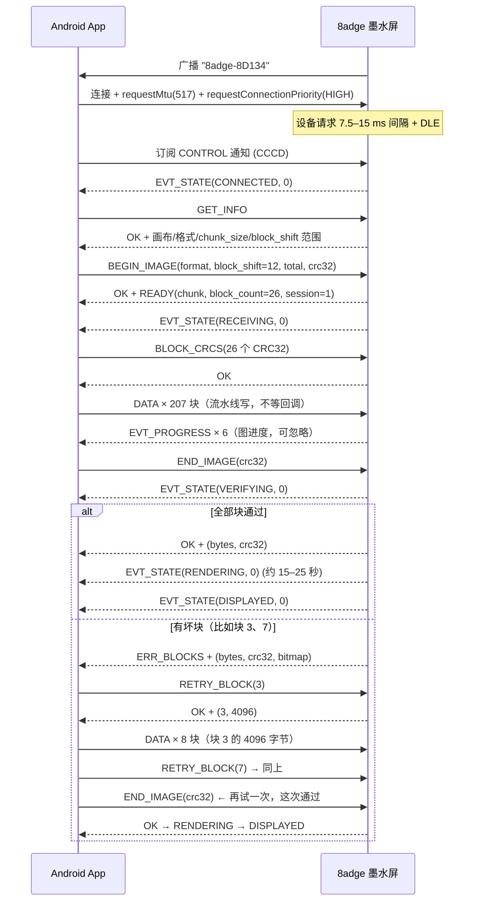

# 8adge 墨水屏 BLE 图片传输协议

> 版本：**协议 v3**（`BLE_PROTOCOL_VERSION = 3`，固件 1.3.1）
> 设备：ESP32-C3-SuperMini + 3.98" 四色墨水屏（面板 768×552 横向，**竖屏使用**）
> 固件：本工程 `ESP32-C3/`（**无 WiFi、无网络、无服务器**，只有 BLE）
> 本文用途：**交给实现 Android App 的开发者/AI 作为唯一规范**。
> 主文档同源文件：`src/ble_protocol.h`（常量）、`src/ble_service.cpp`（协议行为）、
> `src/refresh_guard.{h,cpp}`（刷新冷却与时钟）。
> 改协议必须同步改这几处（本文 + 对应源码）；
> `tools/check_docs.py` 会逐一核对本文引用的常量是否与头文件一致。

---

## ★ 竖屏画布（先说这一条，它影响每一个坐标）

面板本身是 **768×552 横向**的屏，但这个设备是**竖屏**用的（相框就是竖的），所以协议里
**所有坐标都是竖屏的**：

```
竖屏画布 canvas : 552 (宽) x 768 (高)   ← App 按这个做图、按这个打包
面板 panel      : 768 (宽) x 552 (高)   ← 设备自己把 canvas 顺时针转 90° 上去
```

- `552 × 768 = 768 × 552 = 423936` 像素，**旋转是纯像素置换**，不缩放、不裁切。
  所以 2bpp 仍是 **105984 字节**、1bpp 仍是 **52992 字节**，与横屏时完全一样。
- **App 不需要做任何旋转**。图片就按手机屏幕上看到的竖屏样子做：左上角是左上角。
- 画布宽 552 是 **4 的倍数**（2bpp 每行 138 字节）、也是 **8 的倍数**
  （1bpp 每行 69 字节），所以每行都从字节边界开始，不需要补位。
- `GET_INFO` 会同时回报 `image_width/height`（画布，= 作图尺寸）、
  `panel_width/height`（玻璃，仅供参考）和 `rotation`（设备转的角度）。
  **App 应该按 `image_width/height` 作图，不要把 `rotation` 自己也转一遍。**

> 如果烧到机器上发现整屏是躺着的（相框是横的，或者屏在框里装反了），**不需要改 App**：
> 改固件 `config.h` 的 `BLE_ROTATION`（`90` 或 `270`）重新烧录即可。
> 提示屏和图片共用同一个旋转，所以两者永远不会不一致。
>
> （只有 `90` 和 `270` 是合法的：180° 会把画布转成仍然 552×768 的位图，
> 根本盖不住 768×552 的面板。`90` / `270` 就是“正着”和“倒过来”两种。

---

## ★ 刷新冷却：两次刷屏之间必须 ≥ 180 秒（v3 起由固件把关）

**这不是可选项，也不是“为了省电”—— 违反它会造成不可逆的物理损伤。**

四色墨水屏的一次整屏刷新不是“点亮像素”，而是把红/黄/黑/白四种颜料粒子在微胶囊液体里
做一次长达 **15–25 秒的双极性交流电泳**。红、黄颜料迁移率低、表面电荷弱，如果上一次尚未
复位就再施加一次波形，不同极性的粒子会互相吸附**团聚**，结果是：

- **串色、底色泛红、灰残影，且无法用“全白刷新”消除**（不是刷新能恢复的临时现象）；
- 高频充放电还会在 ITO 导电层与介质薄膜上**积聚残留电荷**，破坏微电场平衡；
- 官方规范（E Ink / 佳显 / 微雪）明确要求四色屏**单次刷新间隔 ≥ 180 秒**，
  且绝大多数四色屏在固件层直接**禁用局刷** —— 本固件同样只有整屏刷新。

固件因此做了三件事：

1. `GET_INFO` 回报 `refresh_min_gap_s`（当前 `180`），App 一连接就知道规则；
2. **任何**整屏刷新都计入冷却：图片、`SHOW_HINT` 提示屏、BOOT 键/空闲自动提示屏、测试图；
3. 冷却不足且是 **App 主动发起**时，设备**拒绝刷新**（`ERR_COOLDOWN` + `EVT_REFRESH_BLOCKED`），
   App 弹窗警告，用户确认（`CONFIRM_REFRESH`）后才放行；**没有确认就不刷**。
   确认放行是**受控的例外**：距上次刷新不足 60 秒时连确认也不放行；上一次刷新本身就是
   被确认强刷的，则再想强刷必须等满 180 秒。也就是最坏情况仍然是**平均 180 秒一次**，
   而不是“每弹一次窗就能刷一次”。

### 信任边界（重要）

这块板子**没有任何可信时钟**，所以固件的约束能力有明确边界：

- 同一个上电周期内，设备把第一次 `SYNC_TIME` 当作唯一锚点，之后**累计**允许的“现在”
  最多是 `锚点 + 真实 uptime + 30 秒`。反复发 `SYNC_TIME` 把时间往前推是**无效**的，
  不能靠改时钟缩短冷却。
- 上电后的**第一次** `SYNC_TIME` 无法校验（没有 RTC、没有联网），这是协议的信任边界：
  一个刻意作恶的 App 仍然可以在每次上电后第一次同步时撒谎。固件能做的是：
  - 时钟**落后于**记录时，不再判定“永远不能刷”，而是退回按 uptime 保守判断
    （这样错误/恶意的未来时间也不会把设备永久锁死，最多多等 180 秒）；
  - 强制刷新受上面的 60 秒 / 180 秒限制，无法高频重复。
- 结论：**180 秒对正常 App 与误操作是硬约束；对恶意 App 只能限制在“每次上电一次”**。
  App 侧仍必须把这 180 秒当作真规则来遵守。

### 设备怎么知道“距上次刷屏多久”？

**它自己不知道。** 不联网（无 WiFi、无 SNTP）、`millis()` 每次上电归零、
RTC 断电即失（C3-SuperMini 没有电池脚，RTC 慢速内存只跨深睡/软复位，不跨停电），
NVS 也只能存一个“无法解释的数字”。所以**时钟由 App 提供**：

- App 连接后发 `SYNC_TIME`，内容是 **UTC 秒**（§5.10.1）；
- 设备把该值锚定到自己的单调 uptime 上，之后自己往前走；
- “上次刷屏时间”写进 NVS（16 字节），**所以拔电很久后开机不用白等 3 分钟**：
  App 一连上就能算出“其实已过了 3 天”，立即允许。

### 没有时钟时怎么办（开机后 App 还没连上）

退化为一条**可证明安全**的规则：要求 **本次上电 uptime ≥ 180 秒**。
因为上次刷屏只可能是：

- **本次上电之前** → 真实间隔 = 关机时长 + uptime，而关机时长 ≥ 0，所以 **真实间隔 ≥ uptime**；
- **本次上电之内** → uptime 差值**就是**真实间隔。

两种情况下 `uptime ≥ 180` 都蕴含**真实间隔 ≥ 180 秒**。所以这条回退规则只会**偏保守**，
永远不会放过一次真实的冷却违规。

> ⚠️ 副作用（这是正常行为）：**开机后无人连接的第一次提示屏，最晚会推迟到开机约 3 分钟**
> （而不是 2 分钟）。因为那时拿不到时间，设备只能按 uptime 保守判断。
> 首次烧录的全新设备没有“上次刷屏”记录，所以不受影响，仍是 2 分钟。

### 时区

设备只做**差值**运算，时区在数学上无关；但**必须统一口径**：App 发的是 **UTC**，不是本地时间。
发本地时间的话，跨越夏令时切换的那一次差值会偏 ±1 小时（可能误判“已过 180 秒”）。
设备内部只存 UTC，不做任何转换，也不需要时区表。

---

## 0. 给实现者的最短路径（TL;DR）

1. 扫描并连接广播名为 **`8adge-` + 5 位十六进制** 的设备（例：`8adge-8D134`）。
2. 连接后请求 MTU（要 517），发现服务 `42414447-0001-...`。如果 `GET_INFO` 回了
   `ERR_MTU`（0x0E），说明 MTU 还停在 23，必须先 `requestMtu(517)` 再重试（§5.2）。
3. **必须**对 **CONTROL** 特征打开通知（Notify）。
4. **立刻发一帧 `SYNC_TIME`（0x0A，UTC 秒）** —— 设备自己没有时钟，这是它判断
   “距上次刷屏多久”的**唯一依据**（见上一节）。紧接着 `GET_INFO`，拿到画布尺寸
   与 `refresh_min_gap_s`。
5. 在内存里把图片按**竖屏**做成 **552×768**，量化成 4 色，按 §7 打包成
   **105984 字节**（2bpp）或 **52992 字节**（1bpp），并算好整图 CRC32
   **以及每个块的 CRC32**（§5.9）。
6. `BEGIN_IMAGE`（声明 `block_shift`）→ `BLOCK_CRCS`（块 CRC 表）→
   分块写 DATA → `END_IMAGE`。
7. **距离上次刷屏不足 `refresh_min_gap_s`（默认 180 秒）时，`BEGIN_IMAGE` 会回
   `ERR_COOLDOWN` 并紧跟一帧 `EVT_REFRESH_BLOCKED`**。App 必须弹窗说明“会永久损伤面板”，
   用户确认后发 `CONFIRM_REFRESH(token)`、再重发 `BEGIN_IMAGE`；**用户不确认就什么都不做**（§5.10）。
8. **不要**在窗口边界停下来：`EVT_PROGRESS` 只是进度汇报（旧版叫 `EVT_WINDOW_ACK`，
   已不再是“必须等待”的信号）。你只需要把写入排成流水线、在
   `writeCharacteristic()` 返回 `false` 时重试当前块（§10）。
9. 若 `END_IMAGE` 返回 `ERR_BLOCKS`，它带回来一个**位图**：只重传那几位对应的块
   （`RETRY_BLOCK` + DATA），然后重新 `END_IMAGE`。不用重传整张图。
10. 校验通过后设备开始刷屏（15–25 秒），完成后发 `EVT_STATE = DISPLAYED`。

### ★ 关于速度（先看这一条，否则会慢 3–5 倍）

实测默认状态下只有 **~9.5 kB/s**。这不是协议开销的问题（DATA 帧零开销），而是
**连接间隔**：Android 对未提优先级的连接用 ~48 ms 间隔、每个连接事件只发 1 个包。

固件已经做了它那半边（连接时请求 7.5–15 ms 间隔 + 数据长度扩展），
**但 App 必须配合**：

```kotlin
gatt.requestConnectionPriority(BluetoothGatt.CONNECTION_PRIORITY_HIGH)  // 必须
```

再加上“不等待回调就连续写”的流水线，实测能到 **30–50 kB/s**（详见 §10.1）。
只调用一次 `requestConnectionPriority` 就能快 3 倍以上 —— 很多 App 就漏了这一步。

---

## 1. 角色与总体设计

| 角色 | 说明 |
|---|---|
| **Device**（外设／GATT Server） | 墨水屏。广播、接收图片、刷屏。 |
| **App**（中心设备／GATT Client） | 安卓手机。扫描、连接、把图片编码后传输。 |

设计原则（决定了下面所有细节）：

1. **只有两条特征值**：控制用 `CONTROL`，大数据用 `DATA`。控制帧永远不会被图片数据
   堵在同一个队列里，也永远不会因为图片分片而被截断。
2. **所有设备→手机的报文都走 CONTROL 的 Notify**。只有一个下行流，实现时只需一个
   `onCharacteristicChanged` 分支。
3. **手机负责把图片转成面板原生格式**（缩放、四色量化、抖动、打包），设备不做图像解码。
   ESP32-C3 没有 PSRAM，解码 JPEG/PNG 不现实；而设备把收到的每个字节直接写到它在
   帧缓冲里的最终位置（顺便完成竖屏→横屏的旋转），全程只有**一块** 105984 字节的缓冲。
4. **流控靠链路层，进度报告只供 UI**：BLE 的链路层对每个包都做 ACK/重传，并且
   控制器不会接收超过缓冲的包，所以**不需要**端到端的信用窗口。设备每
   `window_chunks`（32）块发一次 `EVT_PROGRESS` 纯粹是为了进度条 ——
   谁把它当“必须停下等”的信号，谁就白白损失一个往返。
5. **校验按块做，不按整图做**：App 预先声明每 4 KB 的 CRC32，设备逐块验证，
   失败时回报一张位图，App 只重传坏块（§5.9）。
   实测 ~9.5 kB/s 时，整图重传要 11 秒，而**一个字节损坏的块**只要 0.4 秒。
   （注意：如果丢的是**整次写入**，后续字节会整体错位，位图会覆盖从丢包处到末尾的块，
   详见 §11。）
6. **方向由设备负责**：App 按竖屏做图，设备负责旋转。相机/相册里的竖图直接送过来就是正的，
   不用在每个 App 里各写一遍旋转逻辑（见文档开头的「竖屏画布」）。

---

## 2. 设备发现

### 2.1 广播名规则

```
设备名 = "8adge-" + 站点 MAC 的后 5 位十六进制（大写）
示例：  MAC ACEB:E6:18:D1:34  ->  "8adge-8D134"
```

> 后缀取自 WiFi 站点 MAC（`esp_read_mac(..., ESP_MAC_WIFI_STA)` 的字节序），
> 因此同一块板每次上电的名字都一样；App 不应解析这个名字，身份字段由
> `GET_INFO` 回报。

### 2.2 广播内容

| 报文 | 内容 |
|---|---|
| Advertising packet | Flags（`0x06`：LE General Discoverable + BR/EDR Not Supported）+ Complete Local Name |
| Scan Response | 128 位服务 UUID `42414447-0001-4e5a-9c1a-6b7c8d9e0f11` |

- 广播间隔 20–40 ms，可连接（Connectable），无需配对/绑定。
- **名字在广播包里**，因此被动扫描也能看到名字。
- 服务 UUID 在扫描响应里，需要**主动扫描（Active Scan）**才能拿到。

### 2.3 扫描建议

```kotlin
val settings = ScanSettings.Builder()
    .setScanMode(ScanSettings.SCAN_MODE_LOW_LATENCY)   // 主动扫描，必填
    .build()

// 方案 A（推荐，最稳）：不过滤，回调里按名字前缀筛选
scanner.startScan(null, settings, object : ScanCallback() {
    override fun onScanResult(callbackType: Int, result: ScanResult) {
        val name = result.scanRecord?.deviceName ?: return
        if (name.startsWith("8adge-")) { /* 命中 */ }
    }
})

// 方案 B：按服务 UUID 过滤（UUID 在扫描响应里，需要主动扫描）
val filter = ScanFilter.Builder()
    .setServiceUuid(ParcelUuid(UUID.fromString("42414447-0001-4e5a-9c1a-6b7c8d9e0f11")))
    .build()
```

> ⚠️ `ScanFilter.Builder().setDeviceName()` 是**精确匹配**，不能写前缀。要按前缀匹配就必须
> 自己过滤（方案 A）。
> ⚠️ 扫描超时后必须 `stopScan()` 再重开，安卓不允许无限扫描。

---

## 3. GATT 结构

| 角色 | UUID | 属性 | 用途 |
|---|---|---|---|
| Service | `42414447-0001-4e5a-9c1a-6b7c8d9e0f11` | — | 8adge Image Transfer |
| **CONTROL** | `42414447-0002-4e5a-9c1a-6b7c8d9e0f11` | `WRITE` + `WRITE_NR` + `NOTIFY` | 请求 / 响应 / 事件（**全部**结构化报文） |
| **DATA** | `42414447-0003-4e5a-9c1a-6b7c8d9e0f11` | `WRITE` + `WRITE_NR` | 图片原始字节流 |

- CCCD（客户端特征配置描述符）UUID 是标准值
  `00002902-0000-1000-8000-00805f9b34fb`，只需给 **CONTROL** 打开通知。
- 没有加密要求，**不要**发起配对；直接读写即可。
- 同一时刻只允许一个中心设备连接：固件会主动断开第二个连接（不依赖协议栈默认行为）。

---

## 4. 帧格式

CONTROL 上两个方向的报文都用同一个 4 字节头：

| 偏移 | 长度 | 字段 | 说明 |
|---|---|---|---|
| 0 | 1 | `opcode` | 命令码。**bit7 = 1 表示这是设备→手机的报文** |
| 1 | 1 | `seq` | 手机自增的序号，设备在响应里原样回填；事件固定为 `0` |
| 2 | 1 | `status` | 结果码。请求里必须写 `0`；响应里是 §6 的取值 |
| 3 | 1 | `length` | 后面 payload 的字节数（0–255） |
| 4 | N | `payload` | 见各命令定义 |

**所有多字节整数都是小端（little-endian）。**

- 响应 opcode = 请求 opcode `| 0x80` → `GET_INFO` 的响应是 `0x81`。
  请求码限定在 `0x01`–`0x3F`，所以响应码落在 `0x81`–`0xBF`。
- 事件 opcode 从 `0xC0` 起（在响应区间**之上**，永不撞号）。
- 如果请求的 opcode 不在 `0x01`–`0x3F`（比如 `0x00` 或 `0xC5`），
  设备无法用 `opcode | 0x80` 回包（会跑进事件区间），改用
  **`0xE0` 通用错误响应**，payload 是 `u8 offending_opcode`。

CONTROL 的写操作建议用 **Write With Response**（每个命令都能确认落地）；DATA 用
**Write Without Response**（吞吐）。

---

## 5. 命令与响应

### 5.1 命令总表（手机 → 设备）

| opcode | 名称 | payload | 说明 |
|---|---|---|---|
| `0x01` | `GET_INFO` | 无 | 读设备能力 |
| `0x02` | `BEGIN_IMAGE` | 12 字节，见下 | 开始一次图片传输 |
| `0x03` | `END_IMAGE` | 4 字节 CRC32 | 结束并校验 |
| `0x04` | `ABORT` | 无 | 中止当前传输／放弃待刷图片 |
| `0x05` | `SHOW_HINT` | 无 | 让设备画出提示屏 |
| `0x06` | `PING` | 任意 ≤250 字节 | 回环测试，设备原样回显 |
| `0x07` | `SET_OPTIONS` | 1 字节位图 | 设置本次连接的行为开关 |
| `0x08` | `BLOCK_CRCS` | 4 + 4N 字节 | **v2**：每块 CRC32 表（必须在首字节 DATA 之前） |
| `0x09` | `RETRY_BLOCK` | 2 字节 | **v2**：把设备置为“重收某一块” |
| `0x0A` | `SYNC_TIME` | 8 字节（u64 UTC 秒） | **v3**：把设备时钟设成 App 的时间（§5.10.1） |
| `0x0B` | `CONFIRM_REFRESH` | 1 字节 token | **v3**：用户已确认，放行被冷却拦下的那次刷新（§5.10.3） |

未定义的 opcode 一律回 `status = 0x01 (ERR_OPCODE)`；opcode 超出 `0x01`–`0x3F` 时改用
`0xE0` 通用错误响应（见 §4）。

### 5.2 `GET_INFO` → 响应 `0x81`（设备信息）

响应 payload 布局（`len = 39 + nameLen`）：

| 偏移 | 类型 | 字段 | 固定值／含义 |
|---|---|---|---|
| 0 | u8 | `protocol_version` | `3` |
| 1 | u8 | `fw_major` | 固件主版本 |
| 2 | u8 | `fw_minor` | 固件次版本 |
| 3 | u8 | `fw_patch` | 固件修订号 |
| 4 | u16 | `image_width` | **`552`** —— App **作图**的画布宽（竖屏） |
| 6 | u16 | `image_height` | **`768`** —— App **作图**的画布高（竖屏） |
| 8 | u16 | `panel_width` | `768` —— 玻璃实际像素宽（仅供参考） |
| 10 | u16 | `panel_height` | `552` —— 玻璃实际像素高（仅供参考） |
| 12 | u8 | `bpp` | `2` |
| 13 | u8 | `color_count` | `4` |
| 14 | u8[4] | `color_codes` | `{0x00, 0x01, 0x02, 0x03}` = 黑/白/黄/红（见 §7.1） |
| 18 | u32 | `len_2bpp` | `105984`（`BLE_FMT_2BPP` 的字节数） |
| 22 | u32 | `len_1bpp` | `52992`（`BLE_FMT_1BPP` 的字节数） |
| 26 | u16 | `mtu` | 当前协商到的 ATT MTU |
| 28 | u16 | `chunk_size` | 建议的 DATA 单次写入字节数（= `min(512, mtu-3)`） |
| 30 | u16 | `window_chunks` | 每多少块发一次 `EVT_PROGRESS`（当前 `32`，**仅供参考，不是要等待的信号**） |
| 32 | u8 | `rotation` | 设备把画布转上屏的角度，顺时针：`90` 或 `270`（当前 `90`）。**信息性字段** |
| 33 | u8 | `block_shift_min` | **v2**：可接受的最小块号（`11` = 2 KB） |
| 34 | u8 | `block_shift_max` | **v2**：可接受的最大块号（`14` = 16 KB） |
| 35 | u8 | `max_blocks` | **v2**：失败位图能装下的最大块数（`128`） |
| 36 | u8 | `device_name_len` | 设备名长度（UTF-8，无结尾 0） |
| 37 | char[] | `device_name` | 例：`8adge-8D134` |
| 37+nameLen | u16 | `refresh_min_gap_s` | **v3**：两次整屏刷新的最小间隔秒数（`180`） |

> 设备名长度可变，**不要假设固定 11 字节**，一律用 `device_name_len` 截取。
> **v3 的 `refresh_min_gap_s` 追加在名字之后**，所以 `0..36` 的偏移与 v2 完全一致：
> 先按 `device_name_len` 读完名字，再读末尾这两个字节。
> `rotation` 只是让 App 能显示“设备当前是竖屏/旋转了多少度”这类信息；
> **作图永远按 `image_width` × `image_height`，不要在 App 里再转一次。**
>
> **MTU 要求**：这一帧的完整长度是 `43 + device_name_len` 字节（4 字节帧头 + 39 + 名字）。
> 如果协商到的 MTU 装不下，设备回 `ERR_MTU`（0x0E）而**不是**发一个会被协议栈截断的
> 半截帧。收到 `ERR_MTU` 时请把 MTU 请求到 517（或至少 `46 + device_name_len`）后重试。
> 默认 11 字符名字需要 MTU ≥ **57**。

### 5.3 `BEGIN_IMAGE` → 响应 `0x82`（READY）

请求 payload（**固定 12 字节**）：

| 偏移 | 类型 | 字段 | 说明 |
|---|---|---|---|
| 0 | u8 | `format` | `1` = `BLE_FMT_2BPP`，`2` = `BLE_FMT_1BPP` |
| 1 | u8 | `flags` | 保留，必须为 `0` |
| 2 | u8 | `block_shift` | **v2**：块大小 = `1 << block_shift`。`0` = 不做块校验（v1 行为）；否则必须在 `block_shift_min`–`block_shift_max` 之间（推荐 `12` = 4 KB） |
| 3 | u8 | `reserved` | 保留，必须为 `0`（v1 这里是 `u16 reserved` 的高字节） |
| 4 | u32 | `total_len` | 图像字节数，必须**精确等于**该格式的长度 |
| 8 | u32 | `crc32` | 整个图像字节流的 CRC32（见 §8） |

响应 payload（固定 12 字节）：

| 偏移 | 类型 | 字段 | 说明 |
|---|---|---|---|
| 0 | u16 | `chunk_size` | 本会话允许的单块上限，**必须 ≤ 这个值**（也 ≤ `mtu-3`） |
| 2 | u16 | `window_chunks` | 每这么多块发一次 `EVT_PROGRESS`（**仅供参考**） |
| 4 | u32 | `expected_len` | 设备期望的总字节数（回显） |
| 8 | u8 | `session` | 本会话编号（0–255，回卷），`EVT_PROGRESS` 会带上 |
| 9 | u8 | `format` | 回显格式 |
| 10 | u8 | `block_shift` | 回显；`0` 表示设备不接受块校验（或不要求） |
| 11 | u8 | `block_count` | 本次传输的块数（`0` 表示无块校验）；**失败位图的长度就是 `ceil(block_count/8)`** |

失败时 `status` 为：`ERR_LENGTH` / `ERR_BUSY`（正在刷屏或正在画提示屏，等
`EVT_STATE(DISPLAYED/HINT_SHOWN)` 再试）/ `ERR_FORMAT` / `ERR_SIZE` / `ERR_MEM` /
`ERR_MTU`（块校验模式下，失败位图装不进当前 MTU；把 MTU 调大后重试）。
`flags` 或 `reserved` 非 0 会回 `ERR_SIZE`（保留字段必须为 0）。
若上一个传输未完成（传了一半或 `END_IMAGE` 失败），新的 `BEGIN_IMAGE` 会**直接取代并重置**
该会话，因此 `ERR_CRC` 之后可以立刻从 `BEGIN_IMAGE` 整图重传，不必先发 `ABORT`；
`RETRY_BLOCK` 仍是坏块模式下更省流量的路径。

### 5.4 `END_IMAGE` → 响应 `0x83`

请求 payload（固定 4 字节）：`u32 crc32`（与 `BEGIN_IMAGE` 里的值相同）。

> 设备**不**在接收过程中累积整图 CRC，而是在这一刻从帧缓冲里**重算**一遍
> （读回像素 → 重新打包 → 算 CRC）。这样即使中间重传过某些块，报给你的值仍然是
> 屏幕上的真实内容 —— 一个“边收边算”的 CRC 在重传后就一定是错的。
> 代价是 ~50 ms，相对 15–25 秒的刷屏可以忽略。

成功响应 payload（固定 8 字节）：

| 偏移 | 类型 | 字段 |
|---|---|---|
| 0 | u32 | `bytes`（= 接收总字节数，= `total_len`） |
| 4 | u32 | `crc32`（设备重算出来的整图 CRC32） |

失败响应 payload（**至少 8 字节**，两种情况共用）：

| 偏移 | 类型 | 字段 | 说明 |
|---|---|---|---|
| 0 | u32 | `crc32_actual` | 设备重算的整图 CRC32 |
| 4 | u32 | `bytes_received` | 实际接收到的字节数（< `total_len` 就是有丢包） |
| 8 | u8 | `block_count` | 仅当 `status = ERR_BLOCKS`：本次的块数 |
| 9 | u8 | `bad_count` | 仅当 `status = ERR_BLOCKS`：坏块个数（= 位图里 1 的个数） |
| 10 | u8[ceil(block_count/8)] | `bitmap` | 仅当 `status = ERR_BLOCKS`：**位 i 置位 = 块 i 校验失败** |

| status | 含义 | App 应该做什么 |
|---|---|---|
| `0x00 OK` | 校验通过，正在刷屏 | 等 `EVT_STATE = DISPLAYED` |
| `0x0C ERR_BLOCKS` | 有坏块，**可以局部重传** | 对位图里每个置位遍历：`RETRY_BLOCK(block)` + 发回那一块 → 再 `END_IMAGE`（§5.9） |
| `0x06 ERR_CRC` | 整图不符／字节数不够且**没有**块信息 | 从 `BEGIN_IMAGE` 重来 |
| `0x0A ERR_OVERFLOW` | 收到过超过 `total_len` 的字节，而且这张图**最终也没通过校验**：超出的字节被忽略（每个偏移都以 `total_len` 为界，无处可存），真正可疑的是 App 的分块/偏移计算 | 从 `BEGIN_IMAGE` 重来，并检查分块长度计算 |
| `0x03 ERR_STATE` | 没有进行中的传输（`ABORT` 之后，或图片已经在刷屏、`DATA` 还在流水线里）；payload 是 1 字节 `data_hint`（§6.3）| 先读 `data_hint`：`0` = 普通的“没有会话”，`1`/`2` = 你的字节被丢掉了，从 `BEGIN_IMAGE` 重来 |

> 成功响应**恰好 8 字节**（`length` 字节 = `0x08`）。`total_len` 之后多发的字节不会被存储，
> 也不会让一张**已经通过全部校验**的图作废：字节超长只是被忽略并计数，只有校验最终失败时
> 才会回 `ERR_OVERFLOW`，而且会话仍然可重传（不会自动丢弃）。
>
> 失败响应（`ERR_BLOCKS` / `ERR_CRC` / `ERR_OVERFLOW`）之后设备**留在接收态**，并补发一次
> `EVT_STATE(RECEIVING)`，所以按 `EVT_STATE` 跟踪状态的 App 不会一直停在 `VERIFYING`。

> 收到成功响应后设备**立即开始刷屏**（15–25 秒），期间 `loop()` 被占用，
> 但 BLE 协议栈运行在独立任务里，连接不会断。刷屏结束发 `EVT_STATE = DISPLAYED`。
>
> ⚠️ 失败后设备**保持在“可恢复”状态**：不会自动丢掉已收的数据，
> 所以你可以直接 `RETRY_BLOCK`，**不要**先 `BEGIN_IMAGE`（那会从头来过）。
> 只有 `ABORT` 或新的 `BEGIN_IMAGE` 才会清空。

### 5.5 `ABORT` → 响应 `0x84`

清空当前传输并放弃待刷图片，回到空闲。响应 `status = 0x00`。

- **已经在刷屏的图撤不回来**：0x12 波形一旦开始，中途停下会把面板留在不确定状态，所以设备
  照刷到底，`DISPLAYED` 仍会发。这种情况下设备会额外发一条
  `EVT_LOG("render in progress, cannot be aborted")`（装不进当前 MTU 时不发），
  App 应据此提示用户“这张图已经画上去了”。
- 清会话之后，**已经在流水线里的 `DATA` 不会再被接收**（被忽略；必要时设备限频打一行日志）。
  如果之后还发 `END_IMAGE`，它会回 `ERR_STATE` + `data_hint = 1`（§6.3）—— 看到这个值就
  知道要重新 `BEGIN_IMAGE`，而不是等一个永远不会来的 `DISPLAYED`。
- 若图片**已经通过校验**（`END_IMAGE` 回 OK）但还没开始刷屏，`ABORT` 会取消它（不再刷）。

### 5.6 `SHOW_HINT` → 响应 `0x85`

让设备把"请使用蓝牙连接：+ 设备名"画到屏上。
用于 App 里的"找不到设备/重新配对"帮助入口。

- 传输进行中、或有图片正在刷屏、或提示屏正在画：回 `ERR_BUSY`（0x09），**不会**排队。
  （旧固件回 0x00 然后静默丢弃，App 会一直等一个永远不会出现的提示屏。）
- 冷却不足：回 `ERR_COOLDOWN` + `EVT_REFRESH_BLOCKED`；用户确认后必须**重发 SHOW_HINT**
  才生效 —— 确认授权只覆盖它被签发时对应的那条命令。

### 5.7 `PING` → 响应 `0x86`

payload 原样回显，用于测量往返延迟或验证通知链路。

- 回显帧必须装进当前 ATT MTU：payload 最大 `mtu - 7`，上限 250 字节（帧格式的天花板）。
  超了会回 `ERR_MTU`（0x0E），**不是**发一个会被协议栈截断的帧 —— 截断帧里的 `length`
  字段会大于实际收到的字节数，是最难查的一类 App 解析错误。MTU 已协商到 517 时随便发。

### 5.8 `SET_OPTIONS` → 响应 `0x87`

请求 payload：`u8 options`。响应 payload：`u8 options`（回显）。

| 位 | 名称 | 含义 |
|---|---|---|
| `0x01` | `BLE_OPT_DISABLE_HINT` | 禁止设备在空闲 2 分钟后自动画提示屏 |

未定义的位会让设备返回 `ERR_OPTIONS`。**选项在每次新连接时重置为 0。**

### 5.9 块校验与选择性重传（v2，`BLOCK_CRCS` 0x08 / `RETRY_BLOCK` 0x09）

#### 为什么需要它（先回答“有没有帧级重传”）

**链路层已经有逐包重传**：BLE 对每个 LL 包都做 ACK 与重传，并带自带 CRC，
所以“某个包在空气中坏了”永远不会传到 ATT 层。**这一层不需要你做任何事。**

真正会出错的是**这之上**的事：App 调用 `writeCharacteristic()` 返回 `false` 而丢掉了那一块、
手机内存不足、传输中进程被杀、控制器缓冲区溢出。结果是一个**空洞**。

旧版（v1）只有一个整图 CRC32：它能告诉你“有问题”，但**说不出哪里有问题**，
所以只能整张 106 KB 重传 —— 在 9.5 kB/s 下是 11 秒，为了找回 512 字节。
v2 把图切成 4 KB 的块，每块一个 CRC32，**损坏**的块只需重传那一块（≈0.4 秒）。
整次写入丢失时无法知道丢了多少字节，后续数据会错位，位图会包含丢包处及其后的所有块
（仍可逐块修好，但代价更高，见 §11）。

#### 传输前的准备（三处改动）

1. `BEGIN_IMAGE` 的 `block_shift` 填 **`12`**（4 KB 块；也可用 11/13/14）。
   填 `0` 就是旧的 v1 行为（无块校验，失败只能整图重传）。
2. `BEGIN_IMAGE` 的响应会告诉你 `block_count`（4 KB 块下 2bpp 是 **26**、1bpp 是 **13**）。
3. **在发第一个 DATA 字节之前**发一帧 `BLOCK_CRCS`，把这 N 个 CRC32 一口气送过去。
   （在首个 DATA 之后才发会被拒 —— 那时候设备已经收完第一块了。）

#### `BLOCK_CRCS` 请求（`0x08`）

| 偏移 | 类型 | 字段 | 说明 |
|---|---|---|---|
| 0 | u16 | `block_size` | 必须 = `1 << block_shift`（即 `READY` 回显的值） |
| 2 | u16 | `block_count` | 必须 = `READY` 回显的 `block_count` |
| 4 | u32[N] | `crc32[]` | 第 i 项 = 载荷第 `i*block_size` 字节起、长 `block_size` 的 CRC32（**最后一块只算实际存在的字节**） |

- 4 KB 块下报文长度 = `4 + 26*4 = 108` 字节，一帧就能装下（上限 251）。
- 响应：`status = 0x00`，payload 为 `u8 block_count`（回显）。
- 跳过这一步的后果：设备的每块 CRC 都会与默认值 0 不符 → 全部报坏块 →
  你必须把整张图重发一次。**别漏。**

Kotlin 计算块 CRC：

```kotlin
val blockSize = 1 shl 12                     // 4096
val blockCount = (imageBytes.size + blockSize - 1) / blockSize
val blockCrcs = IntArray(blockCount) { i ->
    val from = i * blockSize
    val to = minOf(from + blockSize, imageBytes.size)
    val c = java.util.zip.CRC32()
    c.update(imageBytes, from, to - from)
    c.value.toInt()                          // 小端写入报文
}
```

#### `RETRY_BLOCK` 请求（`0x09`）—— 重传一个块

| 偏移 | 类型 | 字段 | 说明 |
|---|---|---|---|
| 0 | u16 | `block_index` | 要重传的块号（来自失败位图） |
| 2 | u16 | `reserved` | `0` |

响应 payload（4 字节）：

| 偏移 | 类型 | 字段 | 说明 |
|---|---|---|---|
| 0 | u16 | `block_index` | 回显 |
| 2 | u16 | `block_size_to_send` | **接下来要发多少字节**（= 这一块的字节数；末块可能不足 `block_size`） |

- 若 `block_size_to_send == 0`，说明该块已经是好的（你重复请求了）→ 跳过它。
- 请求里偏移 2 的 `reserved` **在存在时**必须为 0（只发 2 字节的旧式短帧仍被接受）。
- **一块一块来**：上一块还没收完（还差字节）就再发 `RETRY_BLOCK`，设备回
  `ERR_BUSY`（0x09）而**不是**换块 —— 换块会把你已经发出去的那半块悄悄丢掉。
  要么先把承诺的字节发完，要么等 15 秒静默超时（Session 复位）后从头 `BEGIN_IMAGE`。
- 之后**必须恰好发这么多字节**的 DATA，设备会把这串字节写回该块的原始偏移
  （块号自带偏移，所以即使之前的丢包让后面的数据整体错位也没关系）。
- 这一块的 CRC 会在收满时重算，并更新位图。
- 修完所有坏块后再发一次 `END_IMAGE`（带同一个整图 CRC），就会通过。
- **只允许一次修一块**，不要并行。

#### 完整“修一块”流程

```kotlin
// 1) END_IMAGE 返回 ERR_BLOCKS，拿到 bitmap/bad_count
// 2) 对每个置位的块：
for (i in 0 until blockCount) {
    if ((bitmap[i / 8].toInt() shr (i % 8)) and 1 == 0) continue
    val r = call(BLE_OP_RETRY_BLOCK, u16(i) + u16(0))   // 等响应
    val need = r.u16At(2)
    if (need == 0) continue
    val from = i * blockSize
    writeDataNoResponse(imageBytes, from, from + need, waitForAck = false)
    // 可选：等 EVT_PROGRESS 的 BLOCK_DONE 标志，或直接串行下一块
}
// 3) 再 END_IMAGE 一次
```

#### 位图（`END_IMAGE` 失败响应里的 `bitmap`）

长度 `ceil(block_count / 8)`（4 KB 块：26 块 → 4 字节）。
**位 i 置位 = 块 i 坏**，`i = byte * 8 + bit`。

```kotlin
fun isBad(bitmap: ByteArray, i: Int) =
    (bitmap[i / 8].toInt() shr (i % 8)) and 1 == 1
```

- **整块 DATA 写入被丢掉**（`writeCharacteristic()` 返回 `false`、控制器缓冲溢出等）也算坏块：
  设备在 `END_IMAGE` 时会把没收到/没收全的块一起标进位图，回 `ERR_BLOCKS` 而不是只回
  `ERR_CRC`；按位图对这些块逐个 `RETRY_BLOCK` 即可恢复，**不需要整图重传**。
  修好全部块后再次 `END_IMAGE` 会通过，即使接收总字节数仍小于 `total_len`
  （块 CRC 已覆盖每个字节，块全对就等价于整图完整）。
- 每个坏块只允许**串行**修一次：`RETRY_BLOCK` → 恰好发送响应里的字节数 → 下一块。

### 5.10 刷新冷却闸门（v3：`SYNC_TIME` 0x0A / `CONFIRM_REFRESH` 0x0B / `EVT_REFRESH_BLOCKED` 0xC3）

完整的物理原因与设备取时钟的方式见本文开头的「★ 刷新冷却」一节。这里只讲线上怎么做。

#### 5.10.1 `SYNC_TIME`（0x0A）—— 给设备一个时钟

请求 payload（**固定 8 字节**）：

| 偏移 | 类型 | 字段 | 说明 |
|---|---|---|---|
| 0 | u64 | `unix_utc` | **UTC 秒** —— 不是毫秒，不是本地时间 |

响应 payload（**固定 8 字节**）：

| 偏移 | 类型 | 字段 | 说明 |
|---|---|---|---|
| 0 | u32 | `last_refresh_utc` | 设备记录的“上次刷屏”UTC 秒；`0` = 没有记录，或那次刷屏无法定时 |
| 4 | u16 | `min_gap_s` | 最小间隔（`180`）|
| 6 | u8 | `clock_known` | `1`（时钟已生效）|
| 7 | u8 | `reserved` | `0` |

- 时间必须落在 **2001-09-09 ～ 2100-01-01** 之间，否则回 `ERR_SIZE`。这个区间就是用来抓
  “把毫秒当秒发”的经典错误的：`System.currentTimeMillis()` 是 13 位数，直接发会被拒，
  而如果用 32 位字段就可能被静默截断成一个“看着像日期”的值 —— 所以这里是 **u64**。
- **同一上电周期内累计超前会被拒**：设备把本次上电的**第一次**成功 `SYNC_TIME` 当作锚点，
  之后任何一次同步最多只能到 `锚点 + 真实 uptime + 30 秒`，否则回 `ERR_SIZE`。
  所以反复发 `SYNC_TIME` 不能把冷却“快进”。（上电后第一次同步无法校验，是信任边界，
  见文档开头的「信任边界」。）
- **建议每次连接都发一次**：换手机、用户改了系统时间、夏令时切换都能自动纠正。
- App 可以用响应里的 `last_refresh_utc` **提前**算好“距上次刷屏还有多久”，
  在界面上先提示，不必等设备拒绝一次。若与本地时钟算出的间隔小于 `min_gap_s`，
  先提示用户会比“发出去再被拦”体验好得多。

Kotlin：

```kotlin
// 连接并订阅通知后立刻发（注意 /1000: 要的是秒）
val nowUtc = System.currentTimeMillis() / 1000L          // UTC 秒
val req = ByteArray(8)
for (i in 0 until 8) req[i] = ((nowUtc ushr (8 * i)) and 0xFF).toByte()   // 小端
val r = call(BLE_OP_SYNC_TIME, req)                      // 等响应
val lastRefreshUtc = r.u32At(0)                          // 0 = 没有记录
val minGapS        = r.u16At(4)                          // 180
```

#### 5.10.2 被拦下时：`ERR_COOLDOWN` + `EVT_REFRESH_BLOCKED`

`BEGIN_IMAGE`（0x02）与 `SHOW_HINT`（0x05）都会刷屏，所以都受冷却管辖。
冷却不足且没有有效授权时：

- **响应**：`status = 0x0D ERR_COOLDOWN`，无 payload；
- **紧接着一个事件** `EVT_REFRESH_BLOCKED`（0xC3）：

| 偏移 | 类型 | 字段 | 说明 |
|---|---|---|---|
| 0 | u8 | `token` | 本次拦截的编号，确认时要原样回传 |
| 1 | u8 | `reason` | `0` = 无时钟（`elapsed_seconds` 是**下界**）；`1` = 有时钟（精确）；`2` = App 时间早于记录（可疑）|
| 2 | u8 | `for_opcode` | 被拒的命令（`0x02` / `0x05`），放行后重发它 |
| 3 | u8 | `reserved` | `0` |
| 4 | u16 | `wait_seconds` | 再等这么久，冷却自然结束 |
| 6 | u16 | `min_gap_seconds` | 设备配置的最小间隔（`180`）|
| 8 | u32 | `elapsed_seconds` | 距上次刷屏的估计时长；`reason = 0` 时是**下界**，文案用“至少”|

**此时设备什么都没刷，也没有进入接收状态**（`BEGIN_IMAGE` 不占 session），屏幕保持原样。

#### 5.10.3 `CONFIRM_REFRESH`（0x0B）—— 用户确认后放行**一次**

请求 payload：`u8 token`（就是 `EVT_REFRESH_BLOCKED` 给的那个）。响应 payload：`u8 token`（回显）。

- token 不符 / 过期 / 已用过，或距上次刷新不足 60 秒（上次是强刷则不足 180 秒）→ `ERR_STATE`。
  App 应把它当成“重新弹一次窗”，不要盲目重试。
- 成功后设备**发一张一次性授权**（120 秒内有效），它只覆盖**一次**刷新：App
  紧接着**重发原来那条命令**（`for_opcode`）即可放行。
- 授权在**面板真正完成刷新时**被消耗（不是收到命令时），所以传输中途 CRC 失败、重传、
  重新 `END_IMAGE` **不需要用户再确认一次**。
- 授权不会“预支”下一次刷新：一次刷完后冷却从头开始，下一次照样要等或再确认。
- **受控例外**（v1.3.0 起）：距上次刷新不足 **60 秒**时，`CONFIRM_REFRESH` 也会被拒
  （`ERR_STATE`，不发放授权）；上一次刷新本身就是“确认强刷”的，则下一次强刷必须等满
  `refresh_min_gap_s`。所以确认不是无限制的，最坏平均仍是 180 秒一次。
  这两个下限和冷却本身用**同一把尺子**：时钟可用时是真实间隔（比如断电三天后不必先跑
  60 秒 uptime），没有时钟时退回 uptime 下界（只会更保守）。
- **授权与被拒命令绑定**：为 `BEGIN_IMAGE` 签发的授权不能用来画提示屏，反之亦然。
  App 必须在确认后重发 `EVT_REFRESH_BLOCKED` 里的 `for_opcode`。
- **用户不确认 = 不刷**：App 不需要回任何一个“取消”报文，什么都不发就是安全的默认行为。

```kotlin
// 收到 EVT_REFRESH_BLOCKED
val token   = evt.u8At(0)
val reason  = evt.u8At(1)
val forOp   = evt.u8At(2)
val waitS   = evt.u16At(4)
val interval= evt.u16At(6)
val elapsed = evt.u32At(8)

val elapsedText = if (reason == 0) "至少 $elapsed 秒" else "$elapsed 秒"
AlertDialog.Builder(ctx)
    .setTitle("面板尚未冷却")
    .setMessage("距上次刷屏 $elapsedText（建议 ≥ $interval 秒，还需等 $waitS 秒）。\n\n" +
                "四色墨水屏间隔不足会造成不可逆的残影与串色。确定要现在强制刷新吗？")
    .setPositiveButton("仍然刷新") { _, _ ->
        call(BLE_OP_CONFIRM_REFRESH, byteArrayOf(token.toByte()))   // 等响应
        retry(forOp)          // 重发被拒的那条命令
    }
    .setNegativeButton("取消", null)   // 什么都不做 = 不刷新
    .show()
```

#### 5.10.4 提示屏（无 App 可问时）

开机后没人连接，2 分钟空闲要画提示屏时**没有 App 可以确认**（也没时钟）。此时设备：

- **不弹窗**（无从弹起）、**不跳过**，而是**等到能证明安全为止**（uptime ≥ 180 秒）再画；
- 所以冷启动后第一次提示屏可能出现在**开机约 3 分钟**处，之后每次连接/断开都正常；
- BOOT 键短按同理：请求会被挂起，一旦合法立即画。

---

## 6. 事件（设备 → 手机，CONTROL 通知）

事件的 `seq = 0`、`status = 0`。

| opcode | 名称 | payload | 说明 |
|---|---|---|---|
| `0xC0` | `EVT_STATE` | `u8 state, u8 error` | 设备状态变化 |
| `0xC1` | `EVT_PROGRESS` | `u32 received, u32 total, u8 session, u8 flags` | **进度报告**（v1 里叫 `EVT_WINDOW_ACK`，已不再是“必须等待”的信用），见 §10 |
| `0xC2` | `EVT_LOG` | UTF-8 文本（无结尾 0） | 调试用，可选显示 |
| `0xC3` | `EVT_REFRESH_BLOCKED` | `u8 token, u8 reason, u8 for_opcode, u8 rsv, u16 wait_s, u16 min_gap_s, u32 elapsed_s` | **v3**：上一条命令因冷却被拒，需要用户确认（§5.10）|

`EVT_PROGRESS.flags`：`0x01` = 刚刚验证完一个块（`BLE_PROGRESS_FLAG_BLOCK_DONE`）。

另外：`0xE0` 是**通用错误响应**（不是事件），只在请求 opcode 越界时出现，
payload 为 `u8 offending_opcode`。

### 6.1 `EVT_STATE` 的 state 取值

| 值 | 名称 | 含义 |
|---|---|---|
| 0 | `IDLE` | 空闲 |
| 1 | `ADVERTISING` | 正在广播 |
| 2 | `CONNECTED` | 已连接（订阅通知后设备会立刻补发一次） |
| 3 | `RECEIVING` | 正在接收图片数据（也用于一次块重传结束、回到正常态时） |
| 4 | `VERIFYING` | 收到 `END_IMAGE`，正在校验 CRC |
| 5 | `RENDERING` | 正在刷屏（15–25 秒） |
| 6 | `DISPLAYED` | 刷屏完成，屏幕上已是新图片 |
| 7 | `HINT_SHOWN` | 提示屏已画出 |
| 8 | `ERROR` | 出错，`error` 字段是 §6.2 的结果码 |
| 9 | `FIXING` | **v2**：已进入"重收某一块"状态；收到这一块后会回到 `RECEIVING` |

### 6.2 结果码（响应 `status` 与 `EVT_STATE.error` 共用）

| 值 | 名称 | 含义 | App 建议动作 |
|---|---|---|---|
| `0x00` | `OK` | 成功 | — |
| `0x01` | `ERR_OPCODE` | 未知命令码 | 代码 bug |
| `0x02` | `ERR_LENGTH` | 帧太短／长度字段不符 | 代码 bug |
| `0x03` | `ERR_STATE` | 当前状态不允许该命令 | 重新走一遍流程 |
| `0x04` | `ERR_FORMAT` | 不支持的图像格式 | 回退到 `BLE_FMT_2BPP` |
| `0x05` | `ERR_SIZE` | `total_len` 与格式不匹配 | 代码 bug |
| `0x06` | `ERR_CRC` | 校验失败或数据不完整 | 从 `BEGIN_IMAGE` 重来 |
| `0x07` | `ERR_MEM` | 设备内存不足 | 提示用户重启设备 |
| `0x08` | `ERR_PANEL` | 面板刷新超时 | 提示用户重试 |
| `0x09` | `ERR_BUSY` | 上一张还在刷屏（等 `DISPLAYED` 再传）；或 `RETRY_BLOCK` 时上一块还没收完（§5.9） | 等 `DISPLAYED` / 先发完上一块承诺的字节再继续 |
| `0x0A` | `ERR_OVERFLOW` | 收到过超过 `total_len` 的字节，**且这张图没通过校验**（超出的字节被忽略，不会作废一张已通过校验的图）| 从 `BEGIN_IMAGE` 重来，并检查分块长度计算 |
| `0x0B` | `ERR_OPTIONS` | 选项位非法 | 只发 §5.8 定义的位 |
| `0x0C` | `ERR_BLOCKS` | **v2**：有块校验失败 | 按位图 `RETRY_BLOCK` 重传坏块（§5.9），**不要**从头重传 |
| `0x0D` | `ERR_COOLDOWN` | **v3**：距上次整屏刷新不足 `refresh_min_gap_s` | 弹窗警告；用户同意后 `CONFIRM_REFRESH(token)` + 重发原命令（§5.10），否则什么都不做 |
| `0x0E` | `ERR_MTU` | **v1.3.0**：这一帧装不进当前 ATT MTU（`GET_INFO` / 失败位图 / `PING` 回显）| 把 MTU 请求到 517（≥ `46 + device_name_len`）后重试；**没有状态被改变** |

### 6.3 `END_IMAGE` 的 `ERR_STATE` payload：`data_hint`

`ERR_STATE` 在 `END_IMAGE` 上携带 1 字节说明（**v1.3.1**；旧 App 忽略这 1 字节即可）：

| 值 | 名称 | 含义 |
|---|---|---|
| `0x00` | `NONE` | 只是“现在没有进行中的传输”，没有额外信息 |
| `0x01` | `DATA_AFTER_END` | 你的 `DATA` 到达时传输已经结束（`END_IMAGE` 已成功、面板正在刷屏，或刚收到 `ABORT`）→ 这些字节没被收到，**没有会话可校验** |
| `0x02` | `DATA_IGNORED` | 你发过超过 `total_len` 的字节，它们被忽略了 |

为什么需要它：设备的节流是**按 `BLE_DATA_CHUNK_MAX` 窗口**计算的（§10），一个高速率的 App
可能在 `END_IMAGE` 之后仍处于“窗口未满”的状态，于是继续把剩下的 `DATA` 写进正在刷屏的设备。
设备会忽略它们（这是必须的，否则会改写正在送屏的字节），但那时**不会**再回任何东西，
`EVT_PROGRESS` 也不会再来 —— 只有这 1 字节能让 App 知道自己在等一个不会出现的 `DISPLAYED`。

App 的稳妥做法：`BEGIN_IMAGE` 收到 `ERR_BUSY`（上一张在刷屏）时，**丢弃本地的窗口计数**
（下一次发完一整张图再等进度），而不要继续按旧计数流水线发。

---

## 7. 图像格式

### 7.1 调色板

| 编码值 | 颜色 | 屏幕 RGB（参考） |
|---|---|---|
| `0` | 黑 Black | `#000000` |
| `1` | 白 White | `#FFFFFF` |
| `2` | 黄 Yellow | `#E8B000` |
| `3` | 红 Red | `#C80000` |

> 这四个编码值就是 `src/epd_398_4color.h` 的 `EPD398_BLACK/WHITE/YELLOW/RED`
> （0/1/2/3），也已在真机上确认过色序：提示屏的四色循环边框就是这份调色板的
> 黑→白→红→黄顺序，实测红、黄不颠倒（2026-09-30）。App 直接照上表编码即可，
> **不需要做任何色序修正**。若换到另一批面板发现红黄颠倒，只改一端
> （固件 `ble_screen.cpp` 的色码，或 App 的编码映射），不要同时改。

### 7.2 `BLE_FMT_2BPP`（格式 1）—— 原生四色

- 尺寸：**竖屏 `552 × 768`**（宽 × 高）
- 每行 `552 / 4 = 138` 字节，行间**无填充**，自上而下
- 每字节 4 个像素：**高位在前**，即 bits 7-6 = 该字节最左边像素，bits 1-0 = 最右像素
- 总长 `138 × 768 = 105984` 字节

```
字节 B 覆盖 x = 4k .. 4k+3
  像素 x=4k   -> (B >> 6) & 0x03
  像素 x=4k+1 -> (B >> 4) & 0x03
  像素 x=4k+2 -> (B >> 2) & 0x03
  像素 x=4k+3 -> (B >> 0) & 0x03
```

Kotlin 打包（注意 `w`/`h` 是**画布**尺寸，即竖屏的 552×768）：

```kotlin
/** palette: IntArray(W*H)，每像素 0..3，行优先（竖屏，行 = y） */
fun pack2bpp(palette: IntArray, w: Int = 552, h: Int = 768): ByteArray {
    val out = ByteArray(w * h / 4)
    var o = 0
    for (y in 0 until h) {
        var x = 0
        while (x < w) {
            val b = (palette[y * w + x]     shl 6) or
                    (palette[y * w + x + 1] shl 4) or
                    (palette[y * w + x + 2] shl 2) or
                     palette[y * w + x + 3]
            out[o++] = b.toByte()
            x += 4
        }
    }
    return out
}
```

> **设备侧怎么处理**：收到字节后不解包成整帧再旋转，而是**直接算目标像素在面板上的
> 位置并写入**（见 `ble_service.cpp` 的 `handleData()`）。所以分块边界落在哪都不影响
> 结果，也不需要第二块 106 KB 的缓冲。App 这边不用关心这些。

### 7.3 `BLE_FMT_1BPP`（格式 2）—— 黑白单色

- 尺寸：**竖屏 `552 × 768`**（宽 × 高）
- 每行 `552 / 8 = 69` 字节，行间无填充
- **bit = 1 表示白，bit = 0 表示黑**（bit7 = 该字节最左边像素）
- 总长 `69 × 768 = 52992` 字节

设备侧展开规则（App 无需实现，但决定了字节序）：每收到 1 个 1bpp 字节，就按位展开成
8 个 2bpp 像素（黑 = `0x00`、白 = `0x01`）并写入旋转后的目标位置。

> 1bpp 的优势：体积只有一半、传输快一倍，而且 App 不需要四色量化器 —— 只要阈值化
> + 抖动即可。代价是丢掉红/黄。

### 7.4 图像预处理建议（App 侧）

1. **裁剪/缩放**到竖屏 552×768（严格放大到满屏，不要留边框，否则面板边缘会有白边）。
2. **量化**：
   - 2bpp：先做 `Saturation/Contrast` 轻调，再按最近色（欧氏距离）分到 4 色；对照片效果最好
     的是 **误差扩散抖动**（Floyd–Steinberg / Atkinson），大面积渐变才不会有色带。
   - 1bpp：转灰度 → 轻微对比度拉伸 → 阈值（或 Floyd–Steinberg 抖动）。
3. **避免大面积纯红/纯黄**：四色屏的黄色偏暗，纯色块会显得脏；照片类内容建议以黑白为主、
   红黄只用于点缀。
4. 先编码一次、算好 CRC 再开始传，不要在传输过程中改字节。

---

## 8. CRC32

- 算法：**标准 CRC-32 / IEEE 802.3**，多项式 `0xEDB88320`（反射），
  初值 `0xFFFFFFFF`，末尾异或 `0xFFFFFFFF`。
- 直接等价于 `java.util.zip.CRC32`、`zlib.crc32`、Python `binascii.crc32`。
- 校验范围：**整段图像 payload 原始字节**（1bpp 时就对 52992 字节的 1bpp 数据算，
  不是展开后的 2bpp 数据）。

Android：

```kotlin
val crc = java.util.zip.CRC32()
crc.update(imageBytes)     // 直接喂整段，110 KB 一次 update 即可
val value: Long = crc.value and 0xFFFFFFFFL
```

**标准测试向量**（可直接写单测）：

| 数据 | 长度 | CRC32 |
|---|---|---|
| `""` | 0 | `0x00000000` |
| `"123456789"` | 9 | `0xCBF43926` |
| 全 `0x55`（全白 2bpp 帧） | 105984 | `0xC6FD3AF0` |
| 全 `0x00`（全黑 2bpp 帧） | 105984 | `0x2D69E75C` |
| 全 `0xFF`（全白 1bpp 帧） | 52992 | `0xFC2E8495` |
| 全 `0x00`（全黑 1bpp 帧） | 52992 | `0x2F809144` |

---

## 9. 完整传输时序



**上限**：一次连接可以连续传多张图，但必须等上一张 `DISPLAYED`（或收到 `ERR_BUSY` 后退避）
再 `BEGIN_IMAGE`。

---

## 10. 速度与流控

### 10.1 为什么默认只有 ~9.5 kB/s，怎么提到 30–50 kB/s

先说结论：**瓶颈不是协议开销，而是连接间隔**。DATA 帧是完全无头的原始字节，
协议的每字节开销是 **0**；`EVT_PROGRESS` 每 16 KB 才 14 字节，占比 0.09%。
把协议“改短”没有任何意义。

实测 9.5 kB/s 的算术恰好对应：**Android 默认 ~48 ms 连接间隔 × 每个连接事件 1 个 512 字节写**
（512 / 0.048 ≈ 10.7 kB/s，再扣掉握手就是 9.5）。链路大部分时间是空闲的。

三件事可以解决，前两件固件已经做了：

| # | 措施 | 谁做 | 效果 |
|---|---|---|---|
| 1 | 请求 **7.5–15 ms** 连接间隔（而不是 48 ms） | **固件**（连接时自动请求 `updateConnParams`） | ×3–4 |
| 2 | **数据长度扩展（DLE）**，LL 载荷 251 字节 | **固件**（连接时 `setDataLen(251)`） | 减少每写一个 ATT 包所需的 LL 分片 |
| 3 | `requestConnectionPriority(HIGH)` + 流水线写 | **App**（必须） | ↑↑ |

设备侧已经在 `onConnect` 里发起了 1 和 2，**但 Android 可以拒绝外设的请求**。
所以 App 这一边是必要的：

```kotlin
// 连接后、传数据前，强烈建议调一次：
gatt.requestConnectionPriority(BluetoothGatt.CONNECTION_PRIORITY_HIGH)
// Android 的 HIGH 对应 11.25–15 ms，比默认快 ~3-4 倍
```

还有一条**反直觉但很重要**的：**不要把写入做成“发一块、等回调、再发下一块”**。
那样每块都要等一个连接事件，吞吐量直接锁死在 `chunk_size / 间隔`。
正确做法是不等回调地连续投递，只在 `writeCharacteristic()` 返回 `false` 时重试：

```kotlin
var off = 0
while (off < imageBytes.size) {
    val end = minOf(off + chunkSize, imageBytes.size)
    if (!writeNoResponse(dataChar, imageBytes, off, end)) {
        Thread.sleep(1)          // 控制器缓冲满了，稍后重试同一块，绝不能丢
        continue
    }
    off = end
}
// 全部投递完后再等 END_IMAGE 的结果
```

> `WRITE_TYPE_DEFAULT`（带响应）逐块确认：实现简单，但每块一个往返，
> 即使间隔降到 15 ms 也只能到 ~34 kB/s 的上限，实际更低。做第一版可以，
> 追求速度请用 `WRITE_TYPE_NO_RESPONSE` + 上面的重试循环。

### 10.2 `EVT_PROGRESS` 不是“必须等待”的信号

这一点很容易搞错，因为 v1 里同一个位置（当时的 `EVT_WINDOW_ACK`）**确实**是要停下来的。

v2 的语义已经变了：

```
设备每收到 window_chunks（32）块就发一次 EVT_PROGRESS，
它只是一行“已经收到 N/total 字节”的进度汇报，供你做进度条。
App 可以完全忽略它，也可以拿它做 UI，但都不应该为它停下来。
```

为什么可以不停？因为 **链路层已经做了流控**：BLE 对每个包做 ACK 与重传，
控制器不会接收超过自己缓冲的包。真正需要节流的信号是
`writeCharacteristic()` 的返回值（`false` = 控制器缓冲满），而不是这个通知。

触发条件：

1. 累计收到 `window_chunks` 块 → 发一次进度（`flags = 0`）；
2. 累计字节数达到 `total_len` → 再发一次（避免进度条停在 92%）；
3. 重传一个块完成 → 发一次，`flags` 带 `BLE_PROGRESS_FLAG_BLOCK_DONE`。

### 10.3 块大小与顺序

- **块大小** = `1 << block_shift`（`READY` 回显的 `block_shift`；默认 4 KB）；
  只有**最后一个块**可以不足。
- **单次 DATA 写入** ≤ `chunk_size`（= `READY` 给的值，且 ≤ `mtu-3`）。
  不要把这两个概念混在一起：块是 CRC 的单位，chunk 是 BLE 一次写的大小。
- **DATA 必须严格按顺序到达**。同一条特征值的写入是有序的，不要并发写。
- 别指望“多开几条特征值并行传” —— BLE 只有一条链路，而且我们的 DATA 就是一条。

---

## 11. 错误处理与重试

| 情况 | 设备行为 | App 应该做什么 |
|---|---|---|
| **有坏块**（v2） | `END_IMAGE` 回 `ERR_BLOCKS` + 位图；**屏幕不变** | 按位图 `RETRY_BLOCK` 重传坏块，再 `END_IMAGE`（§5.9） |
| 整图 CRC 不符（无块信息） | `END_IMAGE` 回 `ERR_CRC`；**屏幕不变** | 从 `BEGIN_IMAGE` 重传整张 |
| 少发了数据（**块模式**） | 未收到/未收全的块被标坏，回 `ERR_BLOCKS` + 位图 | 按位图重传坏块，再 `END_IMAGE` |
| 少发了数据（无块信息） | 回 `ERR_CRC`（`bytes_received < total_len`） | 从 `BEGIN_IMAGE` 重传整张 |
| 连接保持但静默 >15 s | 自动复位 Session，回 `EVT_STATE(CONNECTED)` | 直接重新 `BEGIN_IMAGE`，不会一直 `ERR_STATE` |
| `BEGIN_IMAGE` 后 60 s 还没发第一个 DATA | 自动复位 Session（给图像准备留的宽限） | 准备好后再 `BEGIN_IMAGE` |
| MTU 太小（如 23） | `GET_INFO` 回 `ERR_MTU`；块模式 `BEGIN_IMAGE` 也可能回 `ERR_MTU` | 先 `requestMtu(517)` 再操作 |
| **整块 DATA 写入丢失**（不只是字节损坏） | 后续字节整体错位，`END_IMAGE` 回 `ERR_BLOCKS`，**从丢包处到末尾的块都会置位** | 按位图逐块 `RETRY_BLOCK`（能修好），或 `ABORT` 后整图重传 |
| 多发了数据 | 超出 `total_len` 的字节**被忽略**（无处可存），一张已通过全部校验的图**照样刷**；只有最终校验也失败时才回 `ERR_OVERFLOW` | 从 `BEGIN_IMAGE` 重来，并检查分块长度计算 |
| **刷屏期间仍在流水线写 DATA**（高速率 App 常见） | 字节被忽略，而且**不会有任何回包**；之后 `END_IMAGE` 回 `ERR_STATE` + `data_hint = 1` | 丢掉本地窗口计数，从 `BEGIN_IMAGE` 重来（§6.3）|
| 忘了发 `BLOCK_CRCS` | 全部 26 块都报坏 | 补上 `BLOCK_CRCS` 再重传；**或者直接 `ABORT` 重来** |
| 重传后仍报同一块坏 | 位图里该位仍置位 | 再 `RETRY_BLOCK` 一次；两次都不行就 `ABORT` 重来 |
| **`RETRY_BLOCK` 时上一块还没收完** | 回 `ERR_BUSY`，不换块（换块会丢掉已收到的半块）| 先发完上一块承诺的字节，再请求下一块（§5.9）|
| 传输中断开连接 | 设备丢弃半张图，恢复广播；屏幕不变 | 重连后从头开始（设备不保存进度） |
| 刷屏时又来 `BEGIN_IMAGE` | 回 `ERR_BUSY` | 等 `EVT_STATE(DISPLAYED)` 再试 |
| 设备内存不足 | 回 `ERR_MEM` | 显示“请给设备断电重启” |
| **冷却未到**（v3） | `ERR_COOLDOWN` + `EVT_REFRESH_BLOCKED`；**屏幕不变，也没开始收数据** | 弹窗警告；用户同意后 `CONFIRM_REFRESH` + 重发命令，不同意就什么都不做 |
| 面板 BUSY 超时 | `EVT_STATE(ERROR, ERR_PANEL)` | 允许用户重试一次 |

**超时建议**（经验值）：单次命令响应 5 s；
从 `END_IMAGE` 成功到 `DISPLAYED` 最长等 **60 s**（整屏刷新实测 15–25 s，
但首次上电初始化会慢一些）。

> 重传上限建议：同一块连续失败 **2 次**就放弃，改用 `ABORT` + 整图重传。
> 持续失败通常意味着不是链路问题（例如 App 自己的缓冲区已经和发送循环脱节了）。

---

## 12. 完整会话示例（字节级）

假设 `mtu = 517`（`chunk_size = 512`），传一张 2bpp 图，CRC = `0x2D69E75C`（全黑）。

```
── 手机写 CONTROL ───────────────────────────────────────────
0A 29 00 08                       SYNC_TIME, seq=0x29, len=8
A0 33 F5 68 00 00 00 00           unix_utc = 1760900000（UTC 秒）

── 设备 notify CONTROL ─────────────────────────────────────
8A 29 00 08                       resp(0x8A), seq=0x29, OK, len=8
00 00 00 00                       last_refresh_utc = 0  ← 没有记录（全新设备）
B4 00 01 00                       min_gap_s = 180, clock_known = 1, rsv = 0

── 手机写 CONTROL ───────────────────────────────────────────
01 2A 00 00                       GET_INFO, seq=0x2A

── 设备 notify CONTROL ─────────────────────────────────────
81 2A 00 32                       resp(0x81), seq=0x2A, OK, len=50
03 01 03 00                       protocol=3, fw=1.3.0
28 02 00 03                       image = 552 x 768  (竖屏画布，App 按这个作图)
00 03 28 02                       panel = 768 x 552  (玻璃，仅供参考)
02 04 00 01 02 03                 bpp=2, colors=4, {黑,白,黄,红}
00 9E 01 00                       len_2bpp = 105984
00 CF 00 00                       len_1bpp = 52992
05 02                             mtu = 517
00 02                             chunk_size = 512
20 00                             window_chunks = 32
5A                                rotation = 90 度(0x5A) 顺时针
0B 0E 80                          block_shift 11..14, max_blocks 128   ← v2
0B                                name_len = 11
"8adge-8D134"                     name
B4 00                             refresh_min_gap_s = 180              ← v3
C0 00 00 02 00                    EVT_STATE(CONNECTED, OK)  ← 订阅时的补发

── 手机写 CONTROL ───────────────────────────────────────────
02 2B 00 0C                       BEGIN_IMAGE, seq=0x2B, len=12
01 00 0C 00                       format=2bpp, flags=0, block_shift=12(4KB), rsv=0
00 9E 01 00                       total_len = 105984
5C E7 69 2D                       crc32 = 0x2D69E75C (LE)

── 设备 notify CONTROL ─────────────────────────────────────
82 2B 00 0C                       resp(0x82), OK, len=12
00 02                             chunk_size = 512
20 00                             window_chunks = 32
00 9E 01 00                       expected_len = 105984
01                                session = 1
01                                format = 2bpp
0C                                block_shift = 12
1A                                block_count = 26
C0 00 00 03 00                    EVT_STATE(RECEIVING, OK)

── 手机写 CONTROL：块 CRC 表（必须在首个 DATA 之前）───────────
08 2C 00 6C                       BLOCK_CRCS, seq=0x2C, len=108
00 10                             block_size = 4096
1A 00                             block_count = 26
11 00 1C C7                       crc[0]  = 0xC71C0011   ← 全 0 的 4096 字节
11 00 1C C7                       crc[1]  = 0xC71C0011
…                                 …（共 26 个）…
7C 88 82 3B                       crc[25] = 0x3B82887C   ← 末块只有 3584 字节

── 设备 notify CONTROL ─────────────────────────────────────
88 2C 00 01                       resp(0x88), OK, len=1
1A                                block_count = 26（已接受）

── 手机写 DATA（无响应），共 207 块，流水线发送不等回调 ──────
  块 1..32   : 512 字节 × 32            (16384 字节)
── 设备 notify CONTROL ─────────────────────────────────────
C1 00 00 0A                       EVT_PROGRESS, len=10
00 40 00 00                       received = 16384
00 9E 01 00                       total    = 105984
01                                session  = 1
00                                flags    = 0
  块 33..64 … 共 6 次进度（每 32 块 = 16 KB）

── 手机写 CONTROL ───────────────────────────────────────────
03 2D 00 04                       END_IMAGE, seq=0x2D
5C E7 69 2D                       crc32 = 0x2D69E75C

── 设备 notify CONTROL（正常情况）───────────────────────────
C0 00 00 04 00                    EVT_STATE(VERIFYING, OK)
83 2D 00 08                       resp(0x83), OK, len=8
00 9E 01 00                       bytes = 105984
5C E7 69 2D                       crc32 = 0x2D69E75C（设备从帧缓冲重算）
C0 00 00 05 00                    EVT_STATE(RENDERING, OK)   ← 开始刷屏
   ... 15–25 秒后 ...
C0 00 00 06 00                    EVT_STATE(DISPLAYED, OK)   ← 完成
```

#### 出错时是什么样（假设块 3 和块 7 坏了）

```
── 设备 notify CONTROL ─────────────────────────────────────
C0 00 00 04 00                    EVT_STATE(VERIFYING, OK)
83 2D 00 0E                       resp(0x83), status=0x0C ERR_BLOCKS, len=14
C7 55 79 2B                       crc32_actual（和想要的不一样）
00 9E 01 00                       bytes_received = 105984（字节都到齐了，是内容不对）
1A                                block_count = 26
02                                bad_count   = 2
88 00 00 00                       bitmap = 0x00000088
                                   位 3 和位 7 置位 → 块 3、块 7 坏

── 手机写 CONTROL ───────────────────────────────────────────
09 2E 00 04                       RETRY_BLOCK, seq=0x2E
03 00 00 00                       block_index = 3, reserved = 0
── 设备 notify CONTROL ─────────────────────────────────────
89 2E 00 04                       resp(0x89), OK, len=4
03 00                             block_index = 3
00 10                             block_size_to_send = 4096
C0 00 00 09 00                    EVT_STATE(FIXING, OK)

── 手机写 DATA：恰好 4096 字节（8 块）─────────────────────
── 设备 notify CONTROL ─────────────────────────────────────
C1 00 00 0A                       EVT_PROGRESS（flags=0x01 BLOCK_DONE）
00 9E 01 00                       received = 105984
00 9E 01 00                       total    = 105984
01                                session  = 1
01                                flags    = BLOCK_DONE

  块 7 重复同样的三步（RETRY_BLOCK → DATA × 8 …）

── 手机再写一次 END_IMAGE（同一个整图 CRC）──────────────────
83 2F 00 08                       resp(0x83), OK ← 这次通过
00 9E 01 00                       bytes = 105984
5C E7 69 2D                       crc32 = 0x2D69E75C
```

> 注：`105984 / 512 = 207`，整除，所以最后一块正好 512 字节（不存在"末块不足"）。
> 若换成 1bpp：`52992 / 512 = 103.5`，末块 256 字节，这是"末块可不足"的场景。
>
> `bitmap` 的小端位序：`bitmap[0]` 的 bit0 = 块 0，bit7 = 块 7，`bitmap[1]` 的 bit0 = 块 8…
> 上面 `88 00 00 00` = `0b10001000` → 位 3 和位 7。

#### 被冷却拦下时（假设距上次刷屏 47 秒）

```
── 手机写 CONTROL ───────────────────────────────────────────
02 30 00 0C                       BEGIN_IMAGE, seq=0x30, len=12
01 00 0C 00                       format=2bpp, flags=0, block_shift=12, rsv=0
00 9E 01 00                       total_len = 105984
AA BB CC DD                       crc32 = ...

── 设备 notify CONTROL ─────────────────────────────────────
82 30 00 00                       resp(0x82), status=0x0D ERR_COOLDOWN, len=0
C3 00 00 0C                       EVT_REFRESH_BLOCKED, len=12
07                                token = 7
01                                reason = 1（有时钟，elapsed 精确）
02                                for_opcode = BEGIN_IMAGE
00                                reserved
85 00                             wait_seconds = 133
B4 00                             min_gap_seconds = 180
2F 00 00 00                       elapsed_seconds = 47

   ↑ 设备什么都没刷，也没进入接收状态；屏幕保持原样

── App 弹窗 → 用户点“仍然刷新” ──────────────────────────────
── 手机写 CONTROL ───────────────────────────────────────────
0B 31 00 01                       CONFIRM_REFRESH, seq=0x31, len=1
07                                token = 7

── 设备 notify CONTROL ─────────────────────────────────────
8B 31 00 01                       resp(0x8B), OK, len=1
07                                token = 7  ← 授权已生效（120 秒内有效，一次性）

── 手机重发刚才被拒的那条命令 ──────────────────────────────
02 32 00 0C                       BEGIN_IMAGE, seq=0x32          ← 这次通过
82 32 00 0C                       resp(0x82), OK, len=12
00 02                             chunk_size = 512
20 00                             window_chunks = 32
00 9E 01 00                       expected_len = 105984
01                                session = 1
01                                format = 2bpp
0C                                block_shift = 12
1A                                block_count = 26
C0 00 00 03 00                    EVT_STATE(RECEIVING, OK)
   ... 之后正常走 §9 的时序 ...
```

> 注意对比：主示例里那次 `BEGIN_IMAGE` 是 `session = 1`，这里也是 `session = 1` —— 
> **被冷却拦下的请求不占 session 号**（不消耗会话、不进入接收态），它真的什么都没发生。
>
> 若用户点“取消”，App **什么都不用发**：设备不刷屏（就是默认行为），
> 下一条请求（同一个 App 或另一个 App 都算）依旧会被拦，直到冷却自然结束。
> 想做得精细一点，就拿 `wait_seconds` 做倒计时，到点再重新发。

---

## 13. Android 实现清单（逐项打勾）

### 13.1 权限

```xml
<!-- Android 12+ (API 31+) -->
<uses-permission android:name="android.permission.BLUETOOTH_SCAN"
    android:usesPermissionFlags="neverForLocation" />
<uses-permission android:name="android.permission.BLUETOOTH_CONNECT" />

<!-- Android 11 及以下 -->
<uses-permission android:name="android.permission.BLUETOOTH" android:maxSdkVersion="30" />
<uses-permission android:name="android.permission.BLUETOOTH_ADMIN" android:maxSdkVersion="30" />
<uses-permission android:name="android.permission.ACCESS_FINE_LOCATION" android:maxSdkVersion="30" />
<uses-feature android:name="android.hardware.bluetooth_le" android:required="true" />
```

- API ≤ 30 必须开**定位权限且打开系统定位开关**，否则扫不到任何设备。
- API 31+ 用 `neverForLocation` 可以免定位权限（本设备不广播位置信息，符合该断言）。

### 13.2 连接流程

1. `BluetoothAdapter.getDefaultAdapter().bluetoothLeScanner.startScan(...)`（主动扫描）。
2. 按名字前缀 `8adge-` 命中后 `stopScan()`，`device.connectGatt(ctx, false, cb, TRANSPORT_LE)`。
3. `onConnectionStateChange → STATE_CONNECTED` 后调用 `gatt.discoverServices()`。
4. `onServicesDiscovered` 里按 §3 的 UUID 找到 CONTROL / DATA。
5. `gatt.requestMtu(517)`；在 `onMtuChanged` 里记住实际 MTU（通常 517）。
6. 打开 CONTROL 的通知：
   ```kotlin
   val cccd = ctrl.getDescriptor(UUID.fromString("00002902-0000-1000-8000-00805f9b34fb"))
   gatt.setCharacteristicNotification(ctrl, true)
   cccd.value = BluetoothGattDescriptor.ENABLE_NOTIFICATION_VALUE
   gatt.writeDescriptor(cccd)
   ```
7. `gatt.requestConnectionPriority(BluetoothGatt.CONNECTION_PRIORITY_HIGH)` 提升吞吐。
8. **发 `SYNC_TIME`（UTC 秒）** —— 设备自己没有时钟（§5.10.1），这是它判断“距上次刷屏多久”
   的**唯一依据**。顺手从响应里读出 `last_refresh_utc` 与 `min_gap_s`：
   ```kotlin
   val sync = call(BLE_OP_SYNC_TIME, u64Le(System.currentTimeMillis() / 1000))
   val lastRefreshUtc = sync.u32At(0)
   val minGapS        = sync.u16At(4)
   ```
9. 实现 `EVT_REFRESH_BLOCKED` 的弹窗（§5.10.3）：用户同意 → `CONFIRM_REFRESH(token)`
   + 重发原命令；用户取消 → **什么都不发**。

### 13.3 读写

| 目标 | 写法 |
|---|---|
| CONTROL 写命令 | `ctrl.writeType = WRITE_TYPE_DEFAULT`，`writeCharacteristic(ctrl)`（用 API 33 的 `writeCharacteristic(desc, value, writeType)` 更省事） |
| DATA 写数据块 | `data.writeType = WRITE_TYPE_NO_RESPONSE` |
| 收通知 | `onCharacteristicChanged`（API 33 起带 `value` 参数，旧版用 `characteristic.value`） |

**硬性约束**：Android 的 GATT 一次只允许一个"有响应"的操作在跑。
所以所有 CONTROL 写操作必须**串行排队**，收到 `onCharacteristicWrite` 或对应通知后再发下一个。
DATA 的 `WRITE_TYPE_NO_RESPONSE` 不受此限，也**不需要**等任何窗口信号（§10.2）：
只在 `writeCharacteristic()` 返回 `false` 时重试当前块即可。

> 另：`BEGIN_IMAGE` / `SHOW_HINT` 可能回 `ERR_COOLDOWN`，那是**设备在保护面板**，不是 bug。
> 按 §5.10 弹窗 + 确认后重发即可，不要改成“重试几次就好了”。

### 13.4 其它

- 所有 BLE 回调都不在主线程，UI 更新要 post 回主线程。
- 断线后设备会**自动重新广播**，App `autoConnect=false` 重连即可。
- 在 `onCharacteristicChanged` 里按 §4 解析帧，**不要假设一次通知就是一条完整帧**
  （实际不会分片，但长度字段必须校验）。
- 图片编码（解码/缩放/量化/打包）放到后台线程，别卡 UI。
- 传完一张图后如果 App 主动 `disconnect()`，设备会在 2 分钟后回到提示屏 —— 这在正常
  使用中是期望行为吗？如果不希望，先发 `SET_OPTIONS(0x01)` 关掉它。

---

## 14. 设备侧行为（App 需要知道的"性格"）

| 行为 | 说明 |
|---|---|
| 上电 | **不动屏幕**。墨水屏保持上次的画面（断电也保留）。这是设计要求，不是 bug。 |
| 2 分钟无连接 | 自动画出提示屏：四周四色循环边框 + 中间黑字（“请使用蓝牙连接：+ 设备名”）。**冷启动且 App 还没连上时可能推迟到开机约 3 分钟**（无时钟，只能按 uptime 保守判断，见 §5.10.4）|
| 传过图片后 | **自动**提示屏不会再画（防止覆盖用户的图）；但 App 的 `SHOW_HINT` 或 BOOT 短按仍可显式覆盖。 |
| 断开后 | 空闲计时重新开始（若还没传过图，2 分钟后出提示屏）。**已经通过全部校验、等待刷屏的图片不会因断线而丢失**，仍会正常刷出；只有 `ABORT` 才取消它。 |
| 传输中途静默 | 连接保持但 15 秒内没有新的 DATA / `BLOCK_CRCS` / `RETRY_BLOCK`，设备自动复位到 `CONNECTED`（发 `EVT_STATE(CONNECTED)`），下一次 `BEGIN_IMAGE` 可重新开始，不会永久卡在 `ERR_STATE`。`BEGIN_IMAGE` 之后、第一个 DATA 之前有 60 秒宽限，给 App 准备图像。 |
| 刷屏期间 | 返回 `ERR_BUSY`（约 15–25 秒），**提示屏绘制期间同样如此**。`EVT_STATE(DISPLAYED/HINT_SHOWN)` 一到就可以立刻传下一张。 |
| **刷新冷却**（v3） | 两次整屏刷新强制 ≥180 秒。不足时 App 发起的刷屏回 `ERR_COOLDOWN`，等用户确认；确认放行有 60 秒下限，且连续强刷必须等满 180 秒；无 App 时（按键/空闲提示屏）自动延后到合法为止 |
| 时钟 | 设备**没有自己的时钟**：不联网、`millis()` 上电归零、RTC 断电即失。时间由 App 的 `SYNC_TIME` 提供，之后设备自己往前走。同一上电周期内累计超前 uptime 超过 30 秒的同步会被拒；时钟落后于 NVS 记录时退回 uptime 判断（不会永久锁死） |
| 状态灯（板载蓝灯 GPIO8） | 慢闪 = 广播中；常亮 = 已连接；快闪 = 传输中/出错。 |
| BOOT 键（GPIO9） | 短按 = 画提示屏（若冷却未到则**挂起**，合法后立即画）；长按 8 秒 = 重启。 |
| 方向 | **竖屏**。App 按 `image_width` × `image_height` = 552×768 作图；设备自己旋转上屏。 |
| 支持的图片尺寸 | 只支持 552×768 画布，其它尺寸一律 `ERR_SIZE`。 |
| 一次连接多张图 | 支持，但每张都要满足冷却（首张之后至少等 180 秒或用户确认）。 |
| 持久化 | 图片数据**不保存**（断电后屏幕由墨水屏特性保留，重传即可）。**唯一写 Flash 的是一小段 NVS 记录**：上次刷屏的 UTC 时间（16 字节），让 180 秒冷却能跨断电生效；也就是一个数字，不涉及隐私。 |

---

## 15. 版本与兼容

| 版本 | 变更 |
|---|---|
| 1 | 首次发布：`GET_INFO` / `BEGIN_IMAGE` / `END_IMAGE` / `ABORT` / `SHOW_HINT` / `PING` / `SET_OPTIONS`，2bpp 与 1bpp 两种格式，整图 CRC32 校验，停止-等待式窗口流控。 |
| 1 (rev B) | **竖屏**：作图/打包坐标改为 552×768 画布，设备负责顺时针 90° 旋转上屏（payload 长度不变）。`GET_INFO` 新增 `image_width/height` 与 `rotation`，原来的尺寸字段改名为 `panel_width/height`。提示屏改为四色循环边框 + 中间黑字。 |
| **2** | **块校验与选择性重传**：新增 `BLOCK_CRCS`(0x08) / `RETRY_BLOCK`(0x09)，`ERR_BLOCKS`(0x0C)，`EVT_STATE.FIXING`(9)；失败响应带 `bad` 位图。**提速**：连接时请求 7.5–15 ms 间隔与 DLE，`window_chunks` 16→32 且语义从“必须等待”改为**进度报告**（旧名 `EVT_WINDOW_ACK` → `EVT_PROGRESS`，payload 增加 `flags` 字节）。整图 CRC 改为 `END_IMAGE` 时从帧缓冲重算。 |
| **3**（当前） | **刷新冷却（固件把关）**：任何整屏刷新之间必须≥ 180 秒，否则面板会被**不可逆**损伤（串色/残影）。新增 `SYNC_TIME`(0x0A) / `CONFIRM_REFRESH`(0x0B) / `EVT_REFRESH_BLOCKED`(0xC3) / `ERR_COOLDOWN`(0x0D)。`GET_INFO` 末尾追加 `refresh_min_gap_s`。设备开始往 NVS 写 16 字节的“上次刷屏时间”，因此冷却能跨断电生效。**v1.3.0 收紧**：时钟累计超前限制、确认强刷下限、`ERR_MTU`、提示屏占用帧缓冲、BEGIN/END CRC 一致性、单中心断开。**v1.3.1 修复与收紧**：`END_IMAGE` 成功响应长度恢复为文档规定的 8 字节（原先多发 18 字节未初始化数据）；`total_len` 之后多发的字节改为忽略而非整张作废；`END_IMAGE` 无会话时回 `ERR_STATE` + 1 字节 `data_hint`(§6.3)；失败后补发 `EVT_STATE(RECEIVING)`；`PING` 回显加 MTU 闸门；`RETRY_BLOCK` 校验 `reserved`；确认强刷下限改用真实间隔（有时钟时）。 |

### 从 v1 升级到 v2 需要改什么

最少改动（不想要新功能）：什么都不用改 —— `BEGIN_IMAGE` 的 `block_shift` 填 `0` 就是
完全旧行为，`protocol_version` 只影响你的判版本逻辑。

要拿到块重传和速度，改四处：

1. `GET_INFO.protocol_version == 2` 时，`BEGIN_IMAGE.block_shift = 12`；
2. `BEGIN_IMAGE` 响应多读 `block_shift` / `block_count` 两个字节；
3. 在首个 DATA **之前**发一帧 `BLOCK_CRCS`；
4. `END_IMAGE` 失败时按 `bitmap` 选块重传（`RETRY_BLOCK`）；
   （另：`window_chunks` 不再需要等待，去掉那个停等循环即可提速）

### 从 v2 升级到 v3 需要改什么

必须改三处，否则你的 App 会在用户想马上刷新时“什么也没发生”：

1. 连接并且订阅通知后，**立刻发一帧 `SYNC_TIME`**（UTC 秒）；
2. `GET_INFO` 末尾多出 2 字节 `refresh_min_gap_s`（在可变长名字**之后**，`0..36` 的偏移不变）；
3. 处理 `ERR_COOLDOWN` + `EVT_REFRESH_BLOCKED`：弹窗警告靠用户确认，
   再发 `CONFIRM_REFRESH(token)` + 重发原命令。**不确认就不发任何东西**。

另外建议：把 `SHOW_HINT`、重复选图、连续发多张这些路径都留出 180 秒间隔或走确认流程，
不要把它们当作“随便按”的操作。

兼容性规则：

- App **必须**先读 `GET_INFO.protocol_version`。`3` 走 v3 流程；`2` 没有冷却闸门
  （固件仍会拦，但 App 不会弹窗，只能看到 `ERR_COOLDOWN`）；`1` 按 v1 流程、整图重传。
- **固件 v1.2.0 起只实现 v3**：`protocol_version` 是 `3`。v1/v2 的 App 仍可传输，
  但拿不到提速，而且一旦碰到冷却就无从处理。v1.3.0 增加了 `ERR_MTU`、时钟累计超前
  限制、确认强刷下限、提示屏占用帧缓冲、BEGIN/END CRC 一致性检查（都是向后兼容的
  行为收紧；正常 App 不需要改代码，除了处理 `ERR_MTU`）。
- 未来新增命令码不会再使用 `0x01`–`0x0B`；新增事件从 `0xC4` 起。
- 未识别的命令码设备回 `ERR_OPCODE`，App 应据此优雅降级。
- `GET_INFO` 里的 `chunk_size` / `window_chunks` / `len_*` / `block_shift_min|max` /
  `max_blocks` 是**唯一权威**，App 不要写死常量（现在恰好是 512 / 32 / 105984 / 52992 / 11-14 / 128）。

---

## 16. 自测清单（在真机上验证 App）

### 基础

1. 打开系统蓝牙，能扫到 `8adge-XXXXX`，且**不连接时 2 分钟**后屏幕出现四色循环边框，
   中间黑色显示该名字与“请使用蓝牙连接：”。
2. `GET_INFO.protocol_version == 3`，`device_name` 与屏幕上显示的名字**逐字相同**，
   `image_width/height` = `552/768`。
3. **方向**：传一张内容明确的竖图（例如顶部一条横红带、底部一条横黄带）→
   屏幕应该**顶边在上**。若整屏躺倒，见顶部“竖屏画布”一节（改固件 `BLE_ROTATION`）。
4. 传一张全白 2bpp 图（CRC `0xC6FD3AF0`）→ 屏幕全白；传全黑（`0x2D69E75C`）→ 全黑。
5. 传一张“左半红、右半黄”的图 → 应为左红右黄（色序已实测）；若颠倒，
   说明换了面板批次，改固件或 App 均可（见 §7.1）。

### 速度（最容易漏的项）

6. 传一张 2bpp 图计时：
   - 只调 `requestMtu(517)` → 大约 **10 秒**（~9.5 kB/s，即修复前的状态）；
   - 再加 `requestConnectionPriority(HIGH)` → 应该降到 **3 秒左右**；
   - 再把“发一块等一块”改成流水线 → **2 秒以内**。
   **若第 6 项第一二条没区别，先查是不是漏了 `requestConnectionPriority`。**
7. 串口日志（115200）上确认设备侧的请求发出去了：
   `[BLE] conn params requested: 7.50-15.00 ms...` 与 `[BLE] data length requested: 251 octets`。
   日志里还会打印连上时的实际间隔 `interval xx ms`，可直接判断手机是否接受了请求。

### 重传（v2 核心）

8. 忘了发 `BLOCK_CRCS` 就传 → `END_IMAGE` 应回 `ERR_BLOCKS`（`bad_count == block_count`）。
9. 故意把某一块的几个字节改掉（其余正常）→ `ERR_BLOCKS`，且 `bad_count == 1`、
   位图只置位那一位 → `RETRY_BLOCK` + 重发该块 → 再 `END_IMAGE` 应通过，
   且屏幕画面与“从未出错”完全一致。
10. 故意在一个块的**偏移 0** 和**最后一个字节**各改一个字节 → 仍能定位到同一块。
11. 只发一半就 `END_IMAGE` → `ERR_BLOCKS`（`bytes_received < total_len`，
    受影响块会包含丢包处及其后所有内容）→ 重传这些块也能修好。
    （这也是块号自带偏移的价值：不管丢在哪，重传都落在正确位置。）
12. 传一个大坏块（例如故意把 3 个块弄坏）→ 位图有 3 位置位，逐个 `RETRY_BLOCK` 修完。

### 其它

13. 传到一半 `ABORT` → 可以立刻重新 `BEGIN_IMAGE`。
14. 传图中途关掉手机蓝牙 → 设备恢复广播，屏幕不变；重连后可正常重传。
15. 连续传 3 张不同的图 → 每张都能刷出来（`DISPLAYED` → 下一张）。
    （第 2 张如果在 `DISPLAYED` 之前就发 `BEGIN_IMAGE`，会得到 `ERR_BUSY` —— 应等状态。）
16. 1bpp 全白（`0xFC2E8495`）/全黑（`0x2F809144`）也能正确显示。
17. 传输耗时参考（连接参数正确的前提下）：2bpp 约 1–3 秒，1bpp 约 1–2 秒。

### 刷新冷却（v3 核心）

18. `GET_INFO.protocol_version == 3`，末尾 `refresh_min_gap_s == 180`。
19. 连上后**先发 `SYNC_TIME`**，再连发两张图：第二张的 `BEGIN_IMAGE` 应回
    `ERR_COOLDOWN` + 紧跟 `EVT_REFRESH_BLOCKED`（`for_opcode = 0x02`，`reason = 1`，
    `elapsed_seconds` 是个小值）；弹窗确认后重发才能刷出来。
20. 弹窗时点“取消”（什么都不发）→ 屏幕保持第一张，且再发还是会被拦。
21. 故意把 `SYNC_TIME` 发成**毫秒**（13 位）→ 应回 `ERR_SIZE`，而不是被当成 1970 年。
22. **不连 App**、开机后立刻按 BOOT 键：提示屏**不会立刻出现**；等到开机满 180 秒才会画出来。
23. 传完一张图 → 立刻拔电 → 10 秒后上电并连 App（发 `SYNC_TIME`）→ **仍然应该拒绝**
    （真实间隔只有十几秒）；等满 180 秒或走确认弹窗才能刷。
24. 传完一张图 → 拔电放置 5 分钟 → 上电并连 App（发 `SYNC_TIME`）→ 应**立刻允许**
    （NVS 记录了时间，不必白等 3 分钟）。
25. 断言 NVS 真的写进去了：拔电重上电后，未连接任何 App 的情况下串口日志应出现
    `[GUARD] last refresh <utc> (utc), waiting for the app's clock`。
26. 连上后连续发两次 `SYNC_TIME`，第二次故意把时间往前调 10 分钟 → 应回 `ERR_SIZE`
    （超出 uptime 允许的累计超前），冷却不会被“快进”。
27. 在冷却中确认强刷一次，然后立刻再来第二张并再次确认 → 第二次 `CONFIRM_REFRESH`
    应回 `ERR_STATE`（强制刷新有下限）。
28. 用 MTU 23 的连接发 `GET_INFO` → 应回 `ERR_MTU`，而不是收到半截帧。
29. 传图中途杀掉 App（连接不断）→ 15 秒后收到 `EVT_STATE(CONNECTED)`，可直接重新
    `BEGIN_IMAGE`；若在 `BEGIN_IMAGE` 后、首发 DATA 前杀 App，则有 60 秒宽限。
30. 图片 `END_IMAGE` 成功、`DISPLAYED` 之前断开连接 → 屏幕仍应刷出这张图。

### v1.3.1 收紧项（这几条以前会“静默走掉”，现在有明确答复）

31. `END_IMAGE` 成功响应的 `length` 字节必须是 **`0x08`**（以前是 `0x1A` = 26 字节，
    后面 18 字节是设备的栈垃圾；严格校验长度的 App 会把成功当成畸形帧）。
32. 故意多发一个 DATA 块（例如把最后一个 512 字节再发一遍），其余完全正确 →
    `END_IMAGE` 仍然回 **OK** 并刷屏（超出的字节被忽略）；如果那张图校验本来就是坏的，
    才回 `ERR_OVERFLOW`。
33. 传一张图、`DISPLAYED` 之前**继续按老窗口计数流水线写 DATA**（不要等 `DISPLAYED`）→
    `BEGIN_IMAGE` 可能回 `ERR_BUSY`；此时再发 `END_IMAGE` 应回 `ERR_STATE` 且
    `data_hint == 1`，App 据此丢弃本地窗口计数并重新 `BEGIN_IMAGE`。
34. 用 MTU 23 连接发 `PING` 且 payload 长度 > `23-7=16` → 应回 `ERR_MTU`，而不是收到截断帧。
35. `ABORT` 打在正在刷屏的图上 → 回 `OK`，紧跟 `EVT_LOG("render in progress, cannot be aborted")`
    （MTU 装不下时不发），随后**仍会**收到 `DISPLAYED`。
36. 断电放置 5 分钟后上电、`SYNC_TIME` 之后立刻请求刷新 → 若被拦，`CONFIRM_REFRESH`
    应当**直接成功**（真实间隔远大于 60 秒），不再要求先跑满 60 秒 uptime。
37. 故意"一块没发完就换块"：`RETRY_BLOCK(3)` → 只发一半 → `RETRY_BLOCK(7)` → 第二次应当回
    `ERR_BUSY`，且串口打印该块还剩多少字节；发完块 3 的剩余字节后 `RETRY_BLOCK(7)` 才能生效。

---

## 附录 A：常量速查

```
Service          : 42414447-0001-4e5a-9c1a-6b7c8d9e0f11
CONTROL          : 42414447-0002-4e5a-9c1a-6b7c8d9e0f11   WRITE|WRITE_NR|NOTIFY
DATA             : 42414447-0003-4e5a-9c1a-6b7c8d9e0f11   WRITE|WRITE_NR
CCCD             : 00002902-0000-1000-8000-00805f9b34fb
设备名前缀        : 8adge-
协议版本          : 3
固件版本          : 1.3.1
画布（App 作图）  : 552 x 768 竖屏，2bpp，4 色（0黑/1白/2黄/3红）
面板（玻璃）      : 768 x 552 横向，设备顺时针旋转 90 度上屏
2bpp 长度         : 105984  (138 字节/行)
1bpp 长度         : 52992   (69 字节/行)
默认 chunk_size   : 512     (≤ mtu-3，且 ≤ 512 = NimBLE 特征值上限)
默认 window_chunks: 32      (只是进度报告间隔，**不是要等待的信号**)
块（v2）         : 1 << 12 = 4096 B；2bpp 26 块 / 1bpp 13 块
                   block_shift 可接受 11..14；最多 128 块
刷新最小间隔      : 180 秒（整屏刷新之间，四色屏物理限制，固件把关）
强制刷新下限      : 距上次 ≥60 秒才可确认；上次是强刷则需等满 180 秒
时钟              : 由 App 的 SYNC_TIME 0x0A 提供（UTC 秒）；设备自身无 RTC
                    同一上电周期累计超前 uptime >30 秒的同步会被拒绝
冷却被拦          : ERR_COOLDOWN 0x0D + EVT_REFRESH_BLOCKED 0xC3
                    确认放行：CONFIRM_REFRESH 0x0B + 重发原命令（授权与该命令绑定）
MTU 不足          : ERR_MTU 0x0E（GET_INFO / 失败位图 / PING 回显装不下时）
END_IMAGE 无会话  : ERR_STATE 0x03 + 1 字节 data_hint（0 无 / 1 传输已结束 / 2 字节超长被忽略）
MTU 期望值        : 517（请求值）
连接间隔（设备请求）: 7.5–15 ms，latency 0，timeout 2 s
数据长度扩展      : 请求 251 字节 LL 载荷
提速关键（App 侧）: requestConnectionPriority(CONNECTION_PRIORITY_HIGH)
CRC               : CRC-32/IEEE 802.3，与 java.util.zip.CRC32 相同
```

## 附录 B：v1 → v2 差异速查

> 下表右列是**当前行为**，左列是**旧版行为，仅供对照** —— 不要照左列实现。
> 左列的 `EVT_WINDOW_ACK` 是 v1 的事件名（v1 里它确实是"必须停下等"的停等信用）。

| 项 | v1（旧，勿照此实现） | v2（当前） |
|---|---|---|
| `protocol_version` | 1 | **2** |
| 帧校验 | 整图 CRC32（1 个） | **每块 CRC32**（4 KB 块，2bpp 26 个）+ 整图重算 |
| 失败恢复 | 整图重传（≈11 s @9.5 kB/s） | **只重传坏块**（≈0.4 s） |
| 失败返回 | `ERR_CRC`（无定位信息） | **`ERR_BLOCKS` + 坏块位图** |
| 新增命令 | — | `BLOCK_CRCS` 0x08、`RETRY_BLOCK` 0x09 |
| 进度通知 | `EVT_WINDOW_ACK` 0xC1，**必须停下等** | `EVT_PROGRESS` 0xC1，**仅进度，不必等** |
| `window_chunks` | 16（停等窗口） | 32（报告间隔） |
| 连接参数 | 不干预（~48 ms） | 请求 **7.5–15 ms** + DLE 251 |
| DATA 开销 | 0 字节/块 | 0 字节/块（**没变，本来就不该改**） |
