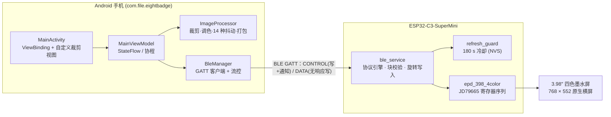

# 8adge

> **一个 8 根飞线的四色墨水屏电子桌牌 / 相框。**
> 手机（Android）通过 **BLE** 把一张做完的图推给 ESP32-C3，设备逐块校验 CRC32 后刷屏；
> 墨水屏断电保留画面，刷新完拔电即可零功耗长期显示。


-lightgrey)

---

## 目录

- [项目简介](#项目简介)
- [参考项目与血缘（建议优先阅读）](#参考项目与血缘建议优先阅读)
- [系统架构](#系统架构)
- [目录结构](#目录结构)
- [硬件](#硬件)
- [快速开始](#快速开始)
- [BLE 协议速览](#ble-协议速览)
- [刷新冷却：为什么必须等 180 秒](#刷新冷却为什么必须等-180-秒)
- [关键技术点](#关键技术点)
- [开发与自测](#开发与自测)
- [相关文档](#相关文档)
- [许可证](#许可证)

---

## 项目简介

**8adge**（Badge = 徽章/电子牌，数字 8 代表 8 根飞线 DIY）由两个互相独立、却只靠一份
[BLE 协议](ESP32-C3/docs/BLE_PROTOCOL.md) 耦合的工程组成：

| 工程 | 语言 / 工具链 | 作用 |
|---|---|---|
| [`ESP32-C3/`](ESP32-C3/) | C++ / PlatformIO (Arduino-ESP32 2.0.17 + NimBLE 1.4.3) | 纯 BLE 固件：接收图片、逐块校验 CRC32、旋转、驱动墨水屏 |
| [`Android/`](Android/) | Kotlin / Gradle (AGP 9.4.1, minSdk 26) | 手机 App：选图、裁剪、调色、14 种抖动、打包并通过 BLE 推图 |

设计上的几条硬约束（都写进了代码和文档，不是口号）：

- **固件没有任何联网能力**：不连 WiFi、没有配网门户、不访问 HTTP / 后端、没有 OTA、没有文件系统。
  唯一的入口是 BLE，手机能做的唯一一件事就是发一张图。唯一写 Flash 的是一小块 NVS 记录
  （16 字节，上次刷屏时间），否则防残影的 180 秒冷却没法跨断电生效。
- **上电不碰屏幕**：墨水屏断电保留画面，这是设计意图。无连接满 2 分钟才画出提示屏。
- **刷新冷却（硬性）**：两次整屏刷新之间强制 ≥ 180 秒，不足时设备回 `ERR_COOLDOWN`，
  App 弹窗、用户确认后才放行（默认不确认就不刷）。
- **竖屏工作**：手机按 **552 × 768** 画布作图，设备自己旋转 90° 送到 **768 × 552** 的横屏面板上。
- **逐块校验**：4 KB 一块 CRC32，全部通过才刷屏；有坏块时只回传坏块位图，手机只重传那几块。

---

## 参考项目与血缘（建议优先阅读）

8adge 不是凭空出现的：**外壳与硬件方案来自社区项目，屏驱来自另一份开源适配**。
动手改本项目之前，建议先把下表的参考项目读一遍 —— 这块面板的坑、这套外壳的装法、
以及整个 InkSight 生态的做法都在它们的文档里。

| 参考项目 | 与本项目的关系 | 许可证 |
|---|---|---|
| ★ [krstc/InkSight_adapt_HUAWEI_eink](https://github.com/krstc/InkSight_adapt_HUAWEI_eink) | **屏驱来源**：[`ESP32-C3/src/epd_398_4color.{h,cpp}`](ESP32-C3/src/epd_398_4color.cpp) 的 JD79665 寄存器序列取自其 `firmware/src/epd_driver.cpp`，本项目在其基础上修正了刷屏问题（VRES = 600、交错栅极寻址、按行窗口） | **MIT**（© 2026 datascale-ai）✅ 兼容 |
| [墨鱼 / InkSight（datascale-ai/inksight）](https://github.com/datascale-ai/inksight) · [官网](https://www.inksight.site/zh) | 同源生态的上游项目（WiFi 联网 + 后端 + 模式广场）。**8adge 没有使用它的任何源码**，也没有沿用它的联网架构（8adge 是纯 BLE） | **MIT**（© 2026 datascale-ai）✅ 兼容 |
| ★ [华为 3.98 寸墨水屏（支持 A0/A1 固件）ESP32-C3 mini 外壳适配 InkSight 墨水屏项目](https://makerworld.com.cn/zh/models/2694038)（MakerWorld 模型 2694038） | **外壳与硬件方案来源**：3D 打印外壳 + 8 线飞线接法。**未使用其任何代码**，本仓库也不包含模型文件 | MakerWorld 模型授权，由模型作者在页面声明（通常限制商用）⚠️ 仅约束模型文件本身 |

一句话血缘：

```text
MakerWorld 2694038 外壳 / 硬件方案
        │（同源生态）
墨鱼 InkSight（MIT，未使用其代码）
        │
krstc/InkSight_adapt_HUAWEI_eink —— 华为 A1 适配 + 屏驱（MIT）
        │  取用：JD79665 寄存器序列 → 并修正刷屏问题
        ▼
8adge（MIT）：纯 BLE 固件 + Android 客户端
```

**代码归属**：除上表明确标注的屏驱寄存器序列外，BLE 协议（v3）、固件协议引擎、180 秒刷新冷却、
提示屏、以及整个 Android 客户端（图像处理 / 14 种抖动 / 传输管道 / UI）**均为本项目自行编写**，
未复制上述 InkSight 系列项目的任何代码。

**许可证结论**：两个源码参考项目都是 **MIT**，与 8adge 的 MIT 发布方式完全兼容
（上游版权声明已按 MIT 要求保留，见 [`LICENSE`](LICENSE) 与 [`THIRD_PARTY_NOTICES.md`](THIRD_PARTY_NOTICES.md)）；
MakerWorld 模型不是代码，其授权只约束外壳模型文件的复用与再分发。

---

## 系统架构



数据流：**选图 → 裁剪/调色/抖动 → 打包成 2bpp 或 1bpp → BEGIN_IMAGE → 分块 DATA(+4 KB CRC32 预注册)
→ END_IMAGE → 设备校验整图 CRC → 旋转写入帧缓冲 → 刷屏（15–25 s）→ EVT_STATE(DISPLAYED)**。

---

## 目录结构

```text
8adge/
├── LICENSE                  MIT License（含上游 MIT 声明）
├── THIRD_PARTY_NOTICES.md   第三方组件 / 参考项目许可清单
├── Android/                 Android 客户端（Kotlin，独立 Gradle 工程）
│   ├── README.md            ★ 客户端详细文档（功能、协议、构建）
│   ├── app/src/main/java/com/file/eightbadge/
│   │   ├── MainActivity.kt              主界面与交互
│   │   ├── ble/BleManager.kt            BLE 连接、状态机、数据管道
│   │   ├── ble/BleProtocol.kt           帧构建/解析、命令与常量
│   │   ├── image/ImageProcessor.kt      裁剪/调色/抖动/打包引擎
│   │   ├── model/DataModels.kt          方向、格式、抖动模式、设备信息、错误码
│   │   └── ui/                          MainViewModel / CropOverlayView / 适配器
│   ├── app/src/test/                     JUnit 单元测试（协议帧、CRC32、打包）
│   └── gradle/libs.versions.toml         依赖版本目录
│
└── ESP32-C3/                ESP32-C3 固件（PlatformIO 工程）
    ├── README.md            ★ 固件详细文档（行为表、改代码前必读）
    ├── platformio.ini       单一环境 ble_398_a1_c3_supermini
    ├── merge_firmware.py    合并 bootloader+分区表+app → bin/ 发布镜像
    ├── docs/BLE_PROTOCOL.md ★★ 完整 BLE 协议规范（写 App 的唯一依据）
    ├── assets/fonts/        提示屏字库源字体（HarmonyOS Sans SC Bold + 许可证）
    ├── bin/                 发布镜像 8adge_BLE_398_A1.bin + SHA256.txt
    ├── src/                 main.cpp / ble_* / refresh_guard / epd_398_4color / led
    └── tools/               字库生成、提示屏预览、接收路径与冷却状态机自测脚本
```

> 仓库只包含上述两个工程的**源码与文档**。用于烧录的第三方 Windows 工具（Espressif
> Flash Download Tool 的可执行文件、日志与临时目录）不纳入版本管理，烧录方式见
> [快速开始](#快速开始)。

---

## 硬件

| 项 | 值 |
|---|---|
| MCU | ESP32-C3-SuperMini（4 MB Flash，无 PSRAM），PlatformIO board = `esp32-c3-devkitm-1` |
| 屏幕 | 3.98″ 四色墨水屏，面板原生 **768 × 552 横向**，2bpp（黑 / 白 / 黄 / 红），驱动 IC JD79665 |
| 屏线（8 根飞线） | DIN→GPIO6、SCK→GPIO4、DC→GPIO1、CS→GPIO7、RST→GPIO2、BUSY→GPIO10（+3V3/GND） |
| 状态灯 | 板载蓝灯 GPIO8（**低电平点亮**） |
| 按键 | BOOT 键 GPIO9（`INPUT_PULLUP`，按下为低）：短按画提示屏，长按 8 秒重启 |

引脚定义集中在 [`ESP32-C3/src/config.h`](ESP32-C3/src/config.h)；
面板几何只在 [`epd_398_4color.h`](ESP32-C3/src/epd_398_4color.h) 里定义一次，画布与面板的关系由
[`ble_geometry.h`](ESP32-C3/src/ble_geometry.h) 的 `static_assert` 在编译期把关。

---

## 快速开始

### 1. 烧录固件

**A. 用发布镜像（推荐，一个文件搞定）**

```powershell
# 合并镜像已含 bootloader + 分区表 + app，烧到 0x0 即可
esptool.py --chip esp32c3 --port COMx write_flash 0x0 ESP32-C3\bin\8adge_BLE_398_A1.bin
```

`ESP32-C3/bin/SHA256.txt` 里是对应的文件名、字节数与 SHA256，可先校验再烧。
也可以在 Espressif 的 Flash Download Tool 里把该 bin 填在偏移 `0x0` 直接下载。

**B. 从源码编译**

```powershell
cd ESP32-C3
pio run                  # 编译（首次会自动拉取 espressif32 平台与 NimBLE-Arduino 1.4.3）
pio run -t upload        # 编译并烧录
pio device monitor       # 串口日志，115200
```

`pio run` 结束后 `merge_firmware.py` 会自动把 bootloader + 分区表 + app 合并并复制到
`ESP32-C3/bin/8adge_BLE_398_A1.bin`。

> 依赖锁定：`h2zero/NimBLE-Arduino@1.4.3`（**必须 1.4.x**，2.x 需要 Arduino-ESP32 3.x / IDF 5）。
> 实测占用：RAM 7.5%（24572 B）/ Flash 29.6%（581342 B），合并镜像 674368 字节。

### 2. 编译安装 App

```powershell
cd Android
.\gradlew.bat assembleDebug     # 产物：app\build\outputs\apk\debug\app-debug.apk
```

或用 Android Studio 打开 `Android/` 目录直接 Run `:app`。要求 JDK 11+、Android SDK（`compileSdk/targetSdk 37`）、
最低运行系统 Android 8.0（API 26）。

### 3. 使用流程

1. 设备上电后广播 `8adge-XXXXX`（`XXXXX` = 站点 MAC 后 5 位十六进制，大写），**不动面板**。
2. App 内搜索并连接设备 → 自动协商 MTU 517、下发 UTC 时间同步（`OP_SYNC_TIME`）。
3. 选图 → 裁剪 / 调色 → 选抖动算法与格式（2bpp 四色 105,984 B 或 1bpp 黑白 52,992 B）→ 预览。
4. 点发送：分块传输 → 设备校验 → 刷屏 15–25 秒 → `EVT_STATE(DISPLAYED)`。
5. 若距上次刷屏不足 180 秒，App 会弹窗提示仍需等待的秒数，用户确认后才放行。

> 无连接满 2 分钟，设备会自动画出提示屏（四色循环边框 + 中间黑色提示文字）。
> 一旦成功显示过手机图片，之后再次空闲**不会**再覆盖它。

---

## BLE 协议速览

完整规范见 **[`ESP32-C3/docs/BLE_PROTOCOL.md`](ESP32-C3/docs/BLE_PROTOCOL.md)**
（GATT 结构、逐帧格式、状态机、时序、字节级会话示例、Android 实现清单、真机自测清单），
下文只是索引。

| 项 | 值 |
|---|---|
| 协议版本 | **v3**（`BLE_PROTOCOL_VERSION = 3`） |
| 广播名 | `8adge-XXXXX` |
| Service UUID | `42414447-0001-4e5a-9c1a-6b7c8d9e0f11`（UUID 里含 ASCII `BADG`） |
| CONTROL 特征 | `42414447-0002-...`：写 + Notify（命令 / 响应 / 事件） |
| DATA 特征 | `42414447-0003-...`：无响应写（图片分块） |
| 画布 | **552 × 768 竖屏**（设备负责旋转到 768 × 552 面板，手机不做旋转） |
| 图像格式 | 格式 1 = `2BPP` 四色 105,984 B；格式 2 = `1BPP` 黑白 52,992 B |
| 协商参数 | MTU 517、chunk 512 B、窗口 32 块 |
| 块校验 | 4 KB 一块 CRC32（IEEE），先 `BLOCK_CRCS` 预注册，坏块用 `RETRY_BLOCK` 精准补传 |
| 冷却 | 两次整屏刷新 ≥ 180 秒（`BLE_REFRESH_MIN_GAP_S`） |

**命令（手机 → 设备）**：`GET_INFO 0x01`、`BEGIN_IMAGE 0x02`、`END_IMAGE 0x03`、`ABORT 0x04`、
`SHOW_HINT 0x05`、`PING 0x06`、`SET_OPTIONS 0x07`、`BLOCK_CRCS 0x08`、`RETRY_BLOCK 0x09`、
`SYNC_TIME 0x0A`、`CONFIRM_REFRESH 0x0B`。

**响应（`op | 0x80`）**：`0x81`–`0x8B`；**事件**：`EVT_STATE 0xC0`、`EVT_PROGRESS 0xC1`、
`EVT_LOG 0xC2`、`EVT_REFRESH_BLOCKED 0xC3`；**通用错误**：`0xE0`。

**结果码**：`OK 0x00`、`ERR_OPCODE 0x01`、`ERR_LENGTH 0x02`、`ERR_STATE 0x03`、`ERR_FORMAT 0x04`、
`ERR_SIZE 0x05`、`ERR_CRC 0x06`、`ERR_MEM 0x07`、`ERR_PANEL 0x08`、`ERR_BUSY 0x09`、
`ERR_OVERFLOW 0x0A`、`ERR_OPTIONS 0x0B`、`ERR_BLOCKS 0x0C`、`ERR_COOLDOWN 0x0D`。

设备状态机：`IDLE(0) → ADVERTISING(1) → CONNECTED(2) → RECEIVING(3) → VERIFYING(4) → RENDERING(5)
→ DISPLAYED(6)`，另有 `HINT_SHOWN(7)`、`ERROR(8)`、`FIXING(9)`。

---

## 刷新冷却：为什么必须等 180 秒

四色墨水屏一次整屏刷新是 **15–25 秒的双极性交流电泳**，间隔不足会让颜料粒子团聚，
造成**不可逆**的串色与残影 —— 所以冷却不是可选项，而是固件里的硬闸门：

- 冷却不足时 `BEGIN_IMAGE` / `SHOW_HINT` 回 `ERR_COOLDOWN` + `EVT_REFRESH_BLOCKED`（含 `token`、
  待等待秒数、被拦截的命令），App 弹窗、用户点确认（`CONFIRM_REFRESH`，携带同一 `token`）后才放行；
  **默认不确认就不刷**。
- 确认是**受控例外**：距上次不足 60 秒不放行，上次是强刷则需等满 180 秒。
- 设备没有可信时钟（不联网、RTC 断电即失）：时钟由 App 的 `SYNC_TIME`（UTC 秒）提供，
  同一上电周期内累计超前 uptime 超过 30 秒的同步会被拒；时钟落后于 NVS 记录时退回 uptime 判断
  （不会永久锁死）。**上电后的第一次同步是信任边界。**
- 每次整屏刷屏后都必须调用 `refreshGuardNoteRefresh(opcode)`，漏一处就等于给面板留了一个
  可以无限高频刷新的入口。

细节与状态机推导见 [`refresh_guard.cpp`](ESP32-C3/src/refresh_guard.cpp) 与协议文档的「刷新冷却」一节。

---

## 关键技术点

**固件侧**

- **一块 105,984 B 帧缓冲全程复用**，在 `NimBLE init` 之前 `malloc` 保证连续；提示屏共用它。
- **旋转在接收时逐像素完成**（`bleSetCanvasPixel()`），所以分块边界落在哪里都不影响结果。
- **整图 CRC 在 `END_IMAGE` 时从帧缓冲重算**，不边收边算 —— 重传之后运行中的 CRC 必然失真。
- **传输静默超时 15 秒**自动复位到 `CONNECTED`（首个 DATA 前 60 秒宽限），避免 App 异常退出后
  设备永久停在 `RECEIVING`。
- **刷屏不在 BLE 回调里做**：校验通过的图交回 `loop()` 渲染，期间帧缓冲被锁，
  `BEGIN_IMAGE` / `SHOW_HINT` 一律回 `ERR_BUSY`，不会出现“半张图 + 半张提示屏”。
- **单中心**：固件主动断开第二个连接。
- **跨任务状态用递归互斥锁**（NimBLE host 任务与 `loop()` 共享会话状态），锁顺序固定 **state → guard**。

**App 侧**

- **14 种抖动算法**：Floyd-Steinberg、Atkinson、JJN、Stucki、Burkes、Sierra 3/2/Lite、
  Bayer 2×2/4×4/8×8、Cluster Dot 4×4、Random Noise、Nearest Color。
- **三种缩放模式**：等比裁剪 `CROP_FILL`、等比留白 `FIT_PAD`、拉伸铺满 `STRETCH`，
  外加交互式矩形裁剪（比例锁定 / 自由）。
- **调色**：饱和度、对比度、亮度、Gamma、拉普拉斯锐化、反色。
- **无丢包流控**：`WRITE_TYPE_NO_RESPONSE` 高频投递 + 动态避让与防爆缓冲；按协议文档 §10.1，
  加上“不等回调连续写”的流水线后实测可达 **30–50 kB/s**（默认 ~9.5 kB/s）。
- **坏块精准补传**：`ERR_BLOCKS` 只回传坏块位图，`RETRY_BLOCK` 单块补传，无需重传全图。
- **异常自愈**：收到 `ERR_STATE` 自动 `ABORT` 复位设备状态机，避免 App 卡在某个阶段。
- **实时日志控制台**：TX/RX 指令帧、设备事件、速度（KB/s）与错误一览；
  内置硬件测试面板（红黄测试条、灰度渐变、PING 延迟、SHOW_HINT、ABORT）。

---

## 开发与自测

### 固件（Python ≥ 3.8）

```powershell
cd ESP32-C3
python tools\check_receive.py          # 逐字节对拍接收路径（旋转/块校验/重传/整图重算）★ 改 handleData() 后必跑
python tools\check_refresh_guard.py    # 对拍 180 秒冷却状态机 ★ 改 refresh_guard.cpp 后必跑
python tools\check_docs.py             # 核对协议文档里的常量与头文件一致 ★ 改协议常量/文档后必跑
python tools\gen_ble_font.py           # 改提示屏文案后重新生成 src/ble_font.h（需 Pillow）
python tools\preview_hint_screen.py --out out.png   # 不烧录验提示屏版式（需 Pillow）
```

前三个脚本只依赖 Python 标准库；`check_receive.py` 是 `ble_service.cpp::handleData()` 的一份
逐行转写，改那个函数必须同步改它。改代码前请先读
[`ESP32-C3/README.md`](ESP32-C3/README.md) 的「改代码前必读」与
[`docs/BLE_PROTOCOL.md`](ESP32-C3/docs/BLE_PROTOCOL.md) 的「自测清单」。

### App（Kotlin / JUnit 4）

```powershell
cd Android
.\gradlew.bat test          # BleProtocolUnitTest / Crc32UnitTest / ImageProcessorUnitTest
```

真机联调时按协议文档「自测清单」逐条勾选（速度、重传、冷却、异常路径是重点）。

---

## 相关文档

| 文档 | 内容 |
|---|---|
| [`ESP32-C3/docs/BLE_PROTOCOL.md`](ESP32-C3/docs/BLE_PROTOCOL.md) | ★★ 完整协议规范：GATT、逐帧格式、状态机、时序、字节级会话示例、Android 实现清单、自测清单 |
| [`ESP32-C3/README.md`](ESP32-C3/README.md) | 固件行为表、硬件引脚、编译烧录、工具脚本、「改代码前必读」 |
| [`Android/README.md`](Android/README.md) | 客户端功能、技术栈、协议实现、图像引擎、UI 与构建指南 |
| [`ESP32-C3/src/ble_protocol.h`](ESP32-C3/src/ble_protocol.h) | 协议常量的唯一来源（UUID、opcode、状态码、画布尺寸） |
| [`Android/.../ble/BleProtocol.kt`](Android/app/src/main/java/com/file/eightbadge/ble/BleProtocol.kt) | 协议常量的 App 侧镜像（两端必须一致） |

---

## 许可证

本项目采用 **MIT License** 发布，全文见 [`LICENSE`](LICENSE)。

- **屏驱**的 JD79665 寄存器序列来自 [krstc/InkSight_adapt_HUAWEI_eink](https://github.com/krstc/InkSight_adapt_HUAWEI_eink)
  （**MIT**，© 2026 datascale-ai），上游版权与许可声明已按 MIT 要求保留。
- 上游 **墨鱼 / InkSight** 系列项目同样是 **MIT**，与本项目的发布方式兼容；
  本项目未使用其源码（详见上方「参考项目与血缘」与 [`THIRD_PARTY_NOTICES.md`](THIRD_PARTY_NOTICES.md)）。
- **MakerWorld 模型 2694038** 的外壳/硬件图纸不是代码，授权由模型作者在模型页面声明；
  本仓库不包含该模型文件，复用外壳请自行遵守页面条款。
- 提示屏字库基于 **HarmonyOS Sans SC Bold**，源字体与许可证（HarmonyOS Sans Fonts License）
  随工程放在 [`ESP32-C3/assets/fonts/`](ESP32-C3/assets/fonts/)。
- 运行时依赖（PlatformIO 的 `espressif32` 平台、NimBLE-Arduino、AndroidX 等）**不随本仓库分发**，
  版本与许可证清单见 [`THIRD_PARTY_NOTICES.md`](THIRD_PARTY_NOTICES.md)。